<div align="center">


# nimaid

**Mermaid diagrams → PNG, GIF and SVG, without a browser.**<br>
Pure Nim · 18 diagram types · CLI, C API, Python and WebAssembly · zero runtime dependencies

[**Live playground**](https://ghazalialshafi.github.io/nimaid/playground/) · [Website](https://ghazalialshafi.github.io/nimaid/) · [Install](#install) · [Docs](docs/README.md) · [Releases](https://github.com/ghazalialshafi/nimaid/releases)

[](https://github.com/ghazalialshafi/nimaid/actions/workflows/ci.yml)
[](https://pypi.org/project/nimaid/)
[](https://www.npmjs.com/package/nimaid)
[](#why-nimaid)
[](LICENSE)

<a href="https://ghazalialshafi.github.io/nimaid/playground/">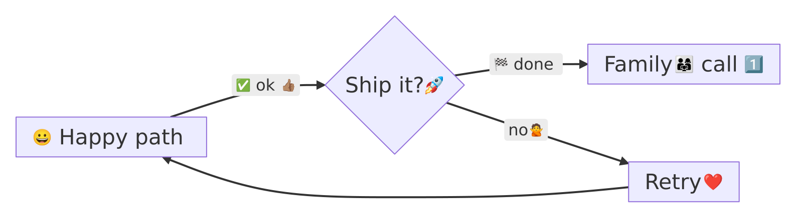</a>

</div>

```sh
pip install nimaid                                   # Python
npm install nimaid                                   # Node, Deno, Bun, browsers (WebAssembly)
nimaid diagram.mmd diagram.png                       # CLI: download from Releases, or build with ./build.sh
```

---

## Why nimaid?

Rendering Mermaid normally means launching headless Chrome. nimaid is a from-scratch implementation that parses Mermaid text,
lays it out with the same algorithm Mermaid uses, and draws it with its own vector engine — so it starts in milliseconds, runs
anywhere Nim compiles, and embeds as an ordinary Nim library.

* **Self-contained.** The whole stack is Nim: parser → layout → **PureVG** (rasteriser, stroker, TrueType reader, SVG loader) → PNG/GIF/SVG encoders. The binary links only libc and libm.
* **Faithful to Mermaid.** The flowchart parser is a port of Mermaid's `flow.jison`; layout reproduces Mermaid's dagre driver (clusters, anchors, self-loops, multi-edges); themes use Mermaid's exact colours.
* **Eighteen diagram types.** Flowchart, sequence, state, ER, class, Gantt, Git graph, mindmap — and the data charts **pie, XY (bar/line), timeline, quadrant, user journey, packet, kanban, radar, treemap and sankey**.
* **Three outputs from one drawing pass.** PNG (own DEFLATE, optional palette), GIF, and SVG that looks identical in every viewer.
* **Real text.** TrueType outlines with kerning, multi-line layout and alignment — plus **full-colour emoji** (skin tones, flags, ZWJ families, keycaps).
* **Five themes** (`default`, `dark`, `forest`, `neutral`, `base`) and every `themeVariables` colour you are likely to need.
* **A library, not just a CLI.** Render to a file, to RGBA pixels, to PNG bytes, or to an SVG string — and use the PureVG engine directly for your own drawing.

## Gallery

<table>
<tr>
<td align="center">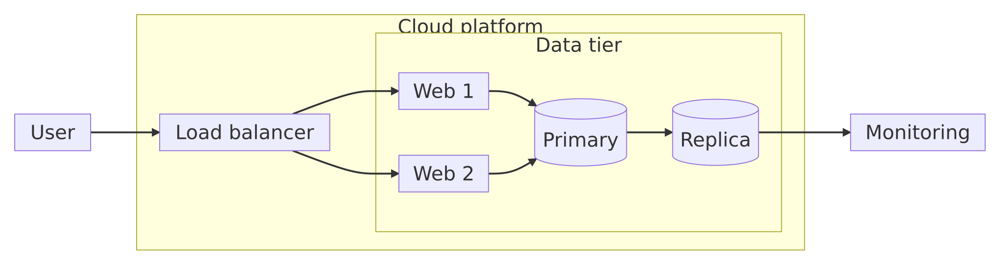<br><sub>Nested subgraphs</sub></td>
<td align="center">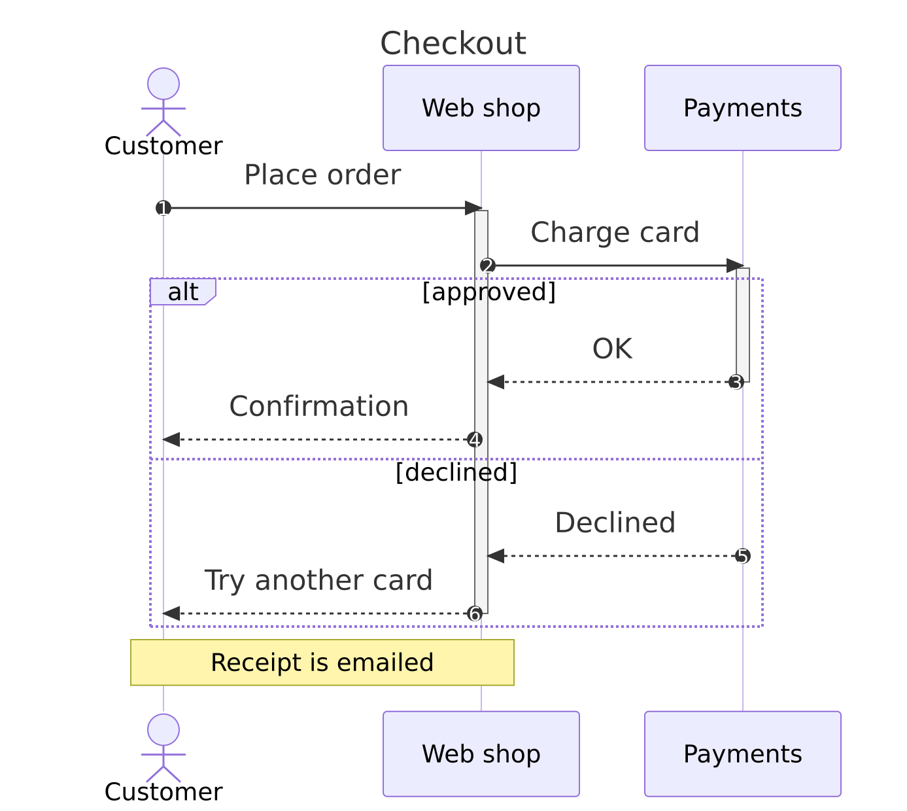<br><sub>Sequence diagram</sub></td>
</tr>
<tr>
<td align="center">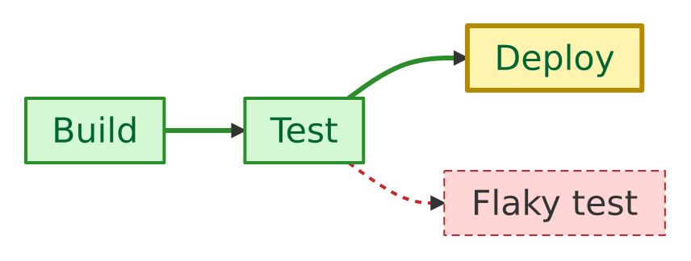<br><sub>classDef / style / linkStyle</sub></td>
<td align="center">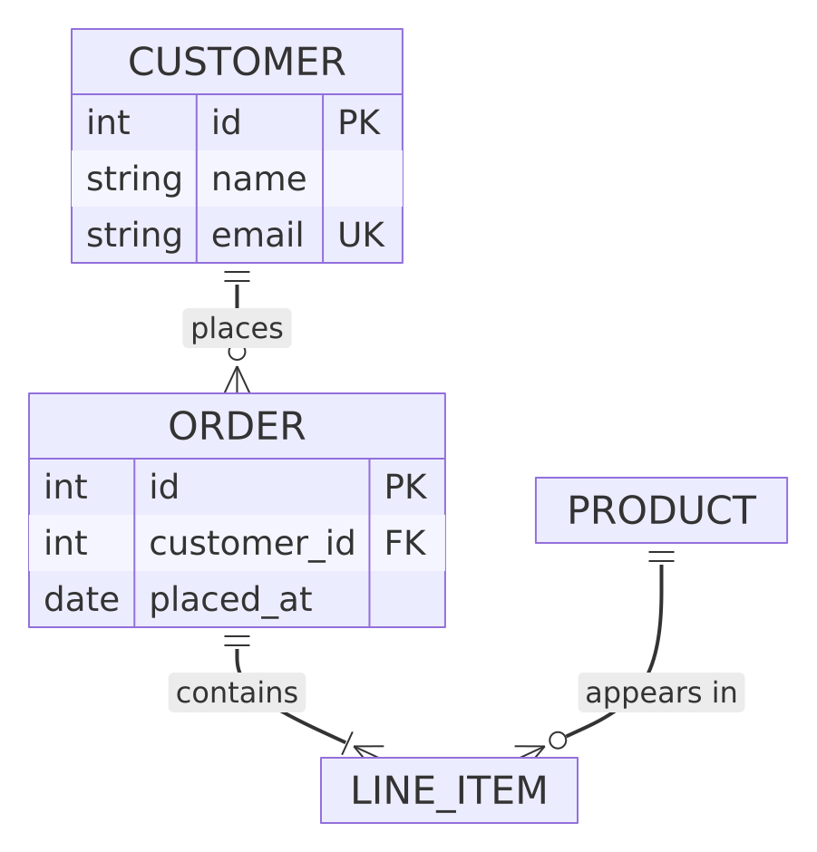<br><sub>Entity–relationship</sub></td>
</tr>
<tr>
<td align="center">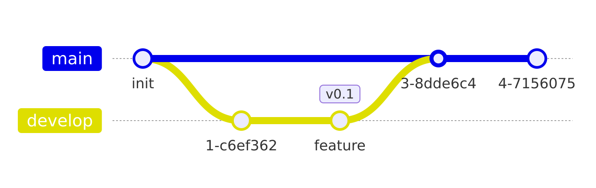<br><sub>Git graph</sub></td>
<td align="center">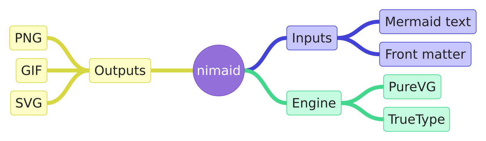<br><sub>Mindmap</sub></td>
</tr>
<tr>
<td align="center">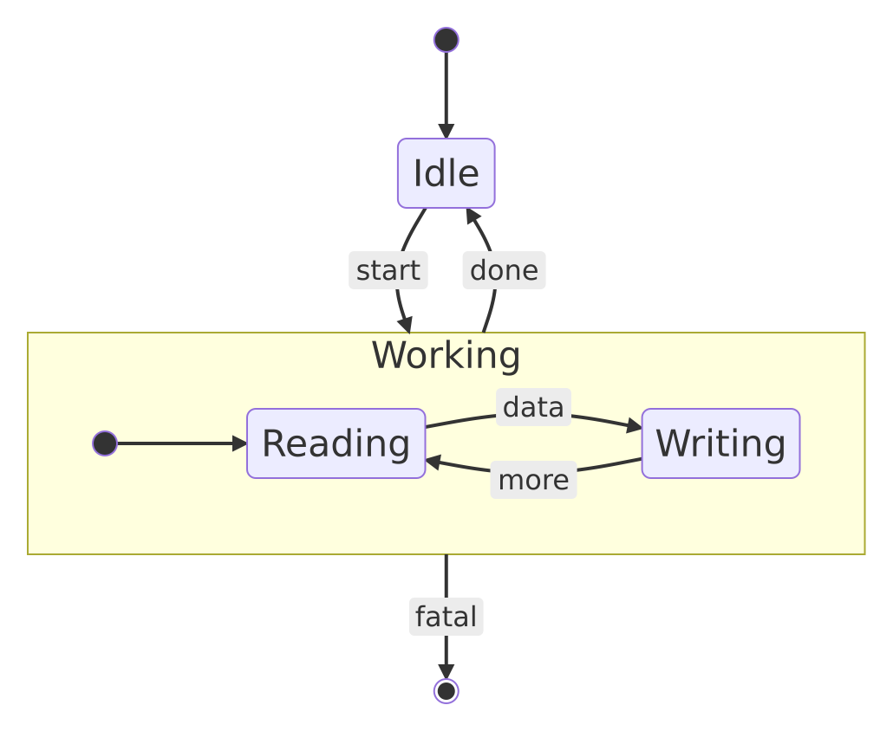<br><sub>State machine</sub></td>
<td align="center">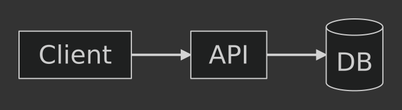<br><sub>Dark theme</sub></td>
</tr>
<tr>
<td align="center">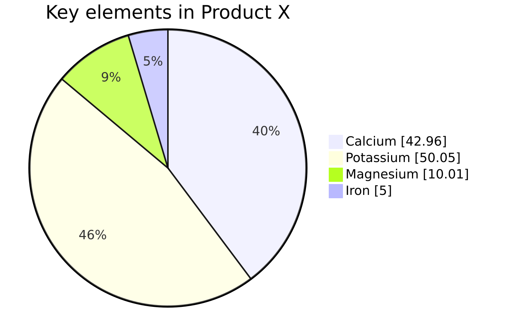<br><sub>Pie chart</sub></td>
<td align="center">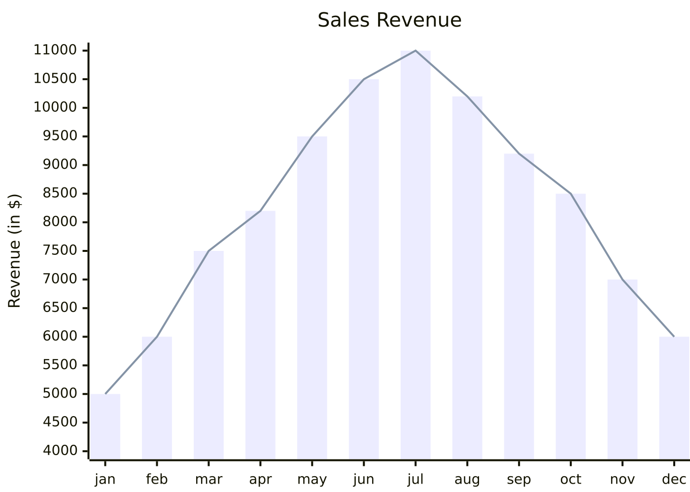<br><sub>XY chart (bars + line)</sub></td>
</tr>
<tr>
<td align="center">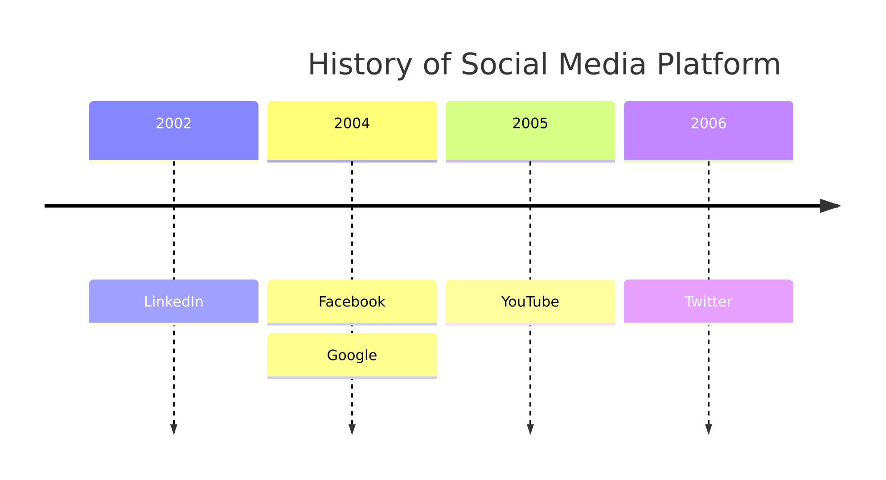<br><sub>Timeline</sub></td>
<td align="center">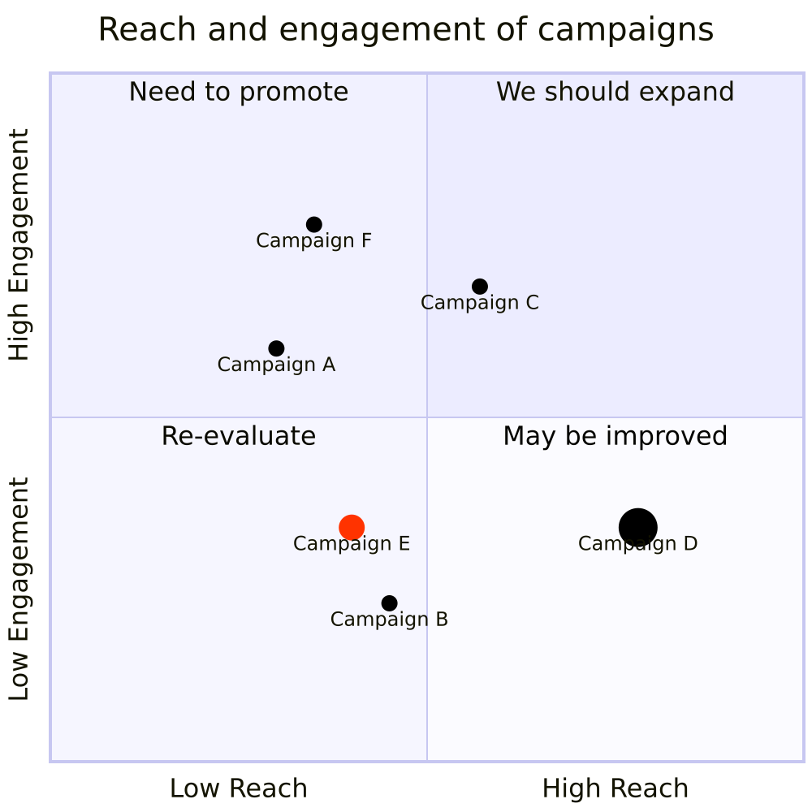<br><sub>Quadrant chart</sub></td>
</tr>
<tr>
<td align="center" colspan="2">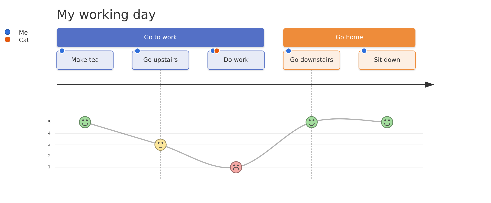<br><sub>User journey</sub></td>
</tr>
<tr>
<td align="center">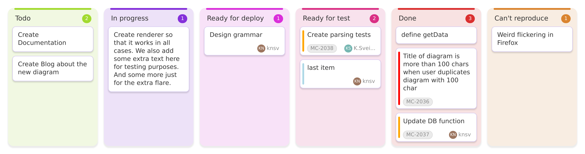<br><sub>Kanban board</sub></td>
<td align="center">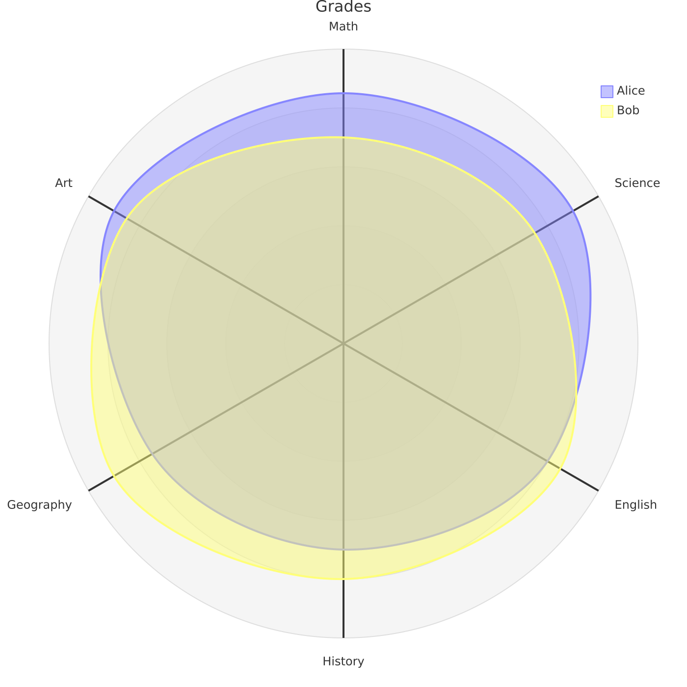<br><sub>Radar chart</sub></td>
</tr>
<tr>
<td align="center">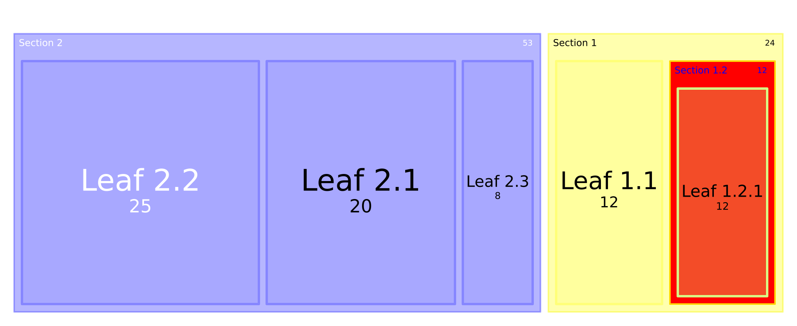<br><sub>Treemap</sub></td>
<td align="center">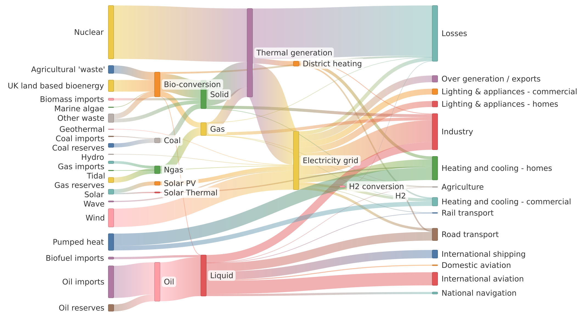<br><sub>Sankey (gradient ribbons, auto-sized)</sub></td>
</tr>
<tr>
<td align="center" colspan="2">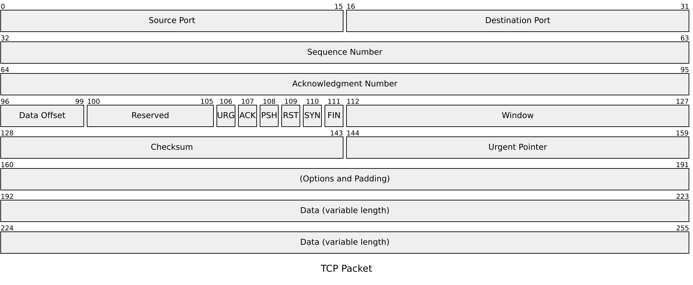<br><sub>Packet diagram (TCP header)</sub></td>
</tr>
</table>

Every image in these docs was produced by nimaid itself (`docs/build_images.sh`).

## Install

| You want | Do this |
|---|---|
| the **command-line tool** | download `nimaid-cli-<version>-<platform>` from [Releases](https://github.com/ghazalialshafi/nimaid/releases) — one static binary, no dependencies, font built in |
| **Python** | `pip install nimaid` (`pip install "nimaid[emoji]"` for colour emoji) |
| **C / C++ / any FFI language** | `nimaid-capi-<version>-<platform>` from Releases: header, static + shared library; see [capi/README.md](capi/README.md) |
| **JavaScript / browser / Node** | `npm install nimaid` (WebAssembly, ~0.8 MB gzipped) or `nimaid-wasm-<version>.tar.gz` from Releases; see [wasm/README.md](wasm/README.md) |
| **Nim** | `nimble install https://github.com/ghazalialshafi/nimaid`, or build from source (below) |

Releases cover Linux (glibc + musl; x86_64, aarch64, armv7, x86, riscv64), macOS (Intel, Apple Silicon), Windows (x64, ARM64, x86), FreeBSD and WebAssembly,
all cross-compiled by [one GitHub Actions workflow](docs/releasing.md) with Zig.

## Quick start

**1. Build** (needs Nim ≥ 2.0 and a C compiler — nothing else):

```sh
./build.sh                 # → bin/nimaid
```

**2. Write a diagram** — `flow.mmd`:

```
flowchart LR
    A[Start] --> B{Is it working?}
    B -->|Yes| C[Ship it]
    B -->|No| D[Debug]
    D --> B
```

**3. Render it:**

```sh
bin/nimaid flow.mmd flow.png                    # retina PNG (scale 2)
bin/nimaid --theme=dark flow.mmd flow-dark.png  # dark theme
bin/nimaid flow.mmd flow.svg                    # scalable vector
```

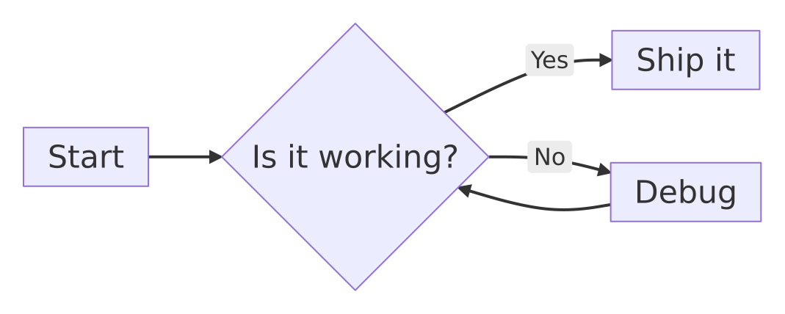

The output format is picked from the file extension. `bin/nimaid --help` lists every option; see the [CLI reference](docs/cli.md).

## Use it as a library

```nim
import nimaid

# one call: Mermaid text → file (.png / .gif / .svg by extension)
renderMermaidToFile("flowchart LR\n A --> B", "out.png", "fonts/DejaVuSans.ttf",
                    emojiFontPath = "fonts/NotoColorEmoji-Regular.ttf", themeName = "forest")

# or in memory
let img = renderMermaidToImage(chart, "fonts/DejaVuSans.ttf", scale = 2.0)    # RGBA pixels
let png = encodePng(img.rgba, img.width, img.height)                          # PNG bytes
let svg = renderMermaidToSvg(chart, "fonts/DejaVuSans.ttf")                   # SVG string
```

Add the repo to your `--path` (or `requires` it from nimble) and `import nimaid`. Full walk-through: [Using nimaid as a library](docs/tutorials/07-library.md).

## Use it from C (and other languages)

`capi/` contains a stable C API (`nimaid.h`), a C++ wrapper, and a one-command cross-build for Linux, Windows, macOS and FreeBSD
(`pip install ziglang && python3 capi/build.py`). DejaVu Sans is embedded, so no font files are needed. See [capi/README.md](capi/README.md).

## Supported diagrams

| Diagram | Starts with | Notes |
|---|---|---|
| Flowchart | `flowchart` / `graph` | ~55 shapes, all link types, subgraphs, `classDef`/`style`/`linkStyle`, curves — a port of Mermaid's grammar and dagre driver |
| Sequence | `sequenceDiagram` | participants/actors, all arrow types, activations, notes, `alt/opt/loop/par/critical/break/rect`, boxes, autonumber |
| State | `stateDiagram` / `-v2` | composite states, choice/fork/join, notes |
| Entity–relationship | `erDiagram` | all cardinalities, attribute tables with PK/FK/UK |
| Class | `classDiagram` | members, annotations, generics, all relation types |
| Gantt | `gantt` | sections, dependencies, crit/active/done/milestone |
| Git graph | `gitGraph` | commit, branch, checkout, merge, cherry-pick, tags |
| Mindmap | `mindmap` | node shapes, coloured branches, emoji |
| Pie | `pie` | `showData`, title, Mermaid's 12-colour theme palette, legend, percentage labels |
| XY chart | `xychart-beta` | bar + line series, category and numeric axes, horizontal orientation, legend, data labels, d3-style ticks |
| Timeline | `timeline` | sections, multi-event periods, multicolour or per-section colours |
| Quadrant chart | `quadrantChart` | four labelled quadrants, styled points (`classDef`, inline styles) |
| User journey | `journey` | sections, scored tasks with faces, actors legend, `journey` config |
| Packet | `packet` | bit fields over 32-bit rows, spanning fields, `+n` widths, themeable |
| Kanban | `kanban` | columns, cards, `@{ticket, assigned, priority}` metadata |
| Radar | `radar-beta` | axes, curves, circle/polygon graticule, legend, `max`/`min`/`ticks` |
| Treemap | `treemap-beta` | d3 squarified layout, nested sections, `classDef`, value formats |
| Sankey | `sankey-beta` | d3-sankey layout, gradient/solid ribbons, node alignment, `nodeColors` |

Details and the not-yet-supported list: [Diagram syntax reference](docs/reference/diagram-syntax.md).

## Output formats

| Extension | What you get | Typical size |
|---|---|---|
| `.png` | Truecolour RGBA, adaptive filters + real DEFLATE (own encoder). `--colors=N` → palette PNG | 45–315 KB at 2× |
| `.gif` | Static GIF89a, median-cut palette | 25–145 KB |
| `.svg` | Scale-free vector. **Outlined text by default** (identical everywhere, no font needed); `--svg-text=text` for selectable `<text>` | 10–60 KB |

SVGs are checked against the PNGs with two independent renderers (resvg and cairosvg): zero visibly different pixels on all examples.
See [Output formats](docs/reference/output-formats.md).

## How it works

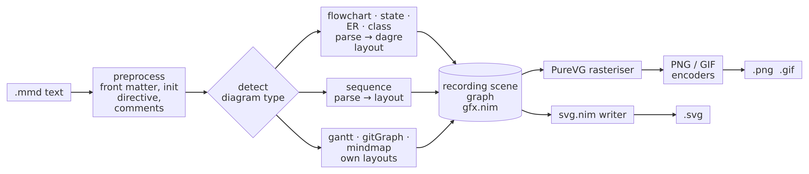

All painters draw into a **recording scene graph**; the same drawing is then replayed by the PureVG rasteriser (PNG/GIF) or serialised by the SVG writer. See [Architecture](docs/architecture.md) and [PureVG](docs/reference/purevg-api.md).

## Documentation

| | |
|---|---|
| **Start here** | [Getting started](docs/getting-started.md) · [CLI reference](docs/cli.md) |
| **Tutorials** | [1 First flowchart](docs/tutorials/01-first-flowchart.md) · [2 Shapes, links, subgraphs](docs/tutorials/02-shapes-links-subgraphs.md) · [3 Styling & themes](docs/tutorials/03-styling-and-themes.md) · [4 Other diagram types](docs/tutorials/04-other-diagrams.md) · [9 Charts](docs/tutorials/09-charts.md) · [5 Text, fonts & emoji](docs/tutorials/05-text-fonts-emoji.md) · [6 PNG, GIF & SVG](docs/tutorials/06-output-formats.md) · [7 Library](docs/tutorials/07-library.md) · [8 Draw with PureVG](docs/tutorials/08-purevg-engine.md) |
| **Reference** | [Diagram syntax](docs/reference/diagram-syntax.md) · [Themes](docs/reference/themes.md) · [Output formats](docs/reference/output-formats.md) · [Library API](docs/reference/library-api.md) · [PureVG API](docs/reference/purevg-api.md) |
| **Understand** | [Architecture](docs/architecture.md) · [FAQ & troubleshooting](docs/faq.md) |
| **Contribute** | [CONTRIBUTING](CONTRIBUTING.md) · [Adding a diagram type](docs/extending.md) · [CHANGELOG](CHANGELOG.md) |

## Project layout

```
src/nimaid_cli.nim        command-line front end
src/nimaid.nim            public library API
src/nimaid/               parsers, layout, painters, charts, encoders (see docs/architecture.md)
src/nimaid/purevg.nim     PureVG engine API   ┐
src/nimaid/purevg/        core · raster · stroke · ttf · svgload     ┘ the vector engine
dagre_nim/                graph layout library (dagre port)
fonts/                    DejaVu Sans + Noto Color Emoji
examples/                 sample diagrams with golden PNGs
docs/                     documentation, tutorial sources, images
tests/                    unit tests, visual regression, Mermaid-spec conformance
```

## Testing

```sh
nim c -r tests/test_purevg.nim        # 49 unit + end-to-end tests: engine, SVG writer and the chart diagrams
python3 tests/visual_regression.py    # every example vs. golden PNG, and SVG vs. PNG (needs Pillow, numpy; resvg-py optional)
python3 tests/conformance.py          # flowchart parser vs. Mermaid's own spec assertions
python3 tests/smoke_examples.py       # every example renders
```

## Performance and footprint

Measured on a single-core x86-64 Linux container, including process start-up and loading both fonts:
`basic` (7 nodes) renders to PNG in ~0.16 s and SVG in ~0.04 s; the large `complex` example takes ~0.3 s; the heaviest example (`allshapes`, 55 shapes) ~0.9 s.
The binary is 1.9 MB and depends only on libc and libm.

## Limitations

One text font at a time (no bold/italic runs), no CJK glyphs in the bundled font, no `look: handDrawn`, KaTeX or HTML labels, no click callbacks.
Requirement, C4, block, architecture, treeView, venn, ishikawa and the newest Mermaid diagram types are not implemented yet.
Full list: [FAQ](docs/faq.md#what-is-not-supported).

## Credits and license

MIT licensed — see [LICENSE](LICENSE).
Copyright (c) 2026 Ghazali

Third-party components (DejaVu Sans, Noto Color Emoji, nanosvg, dagre) and their licenses are listed in [THIRD_PARTY.md](THIRD_PARTY.md).
