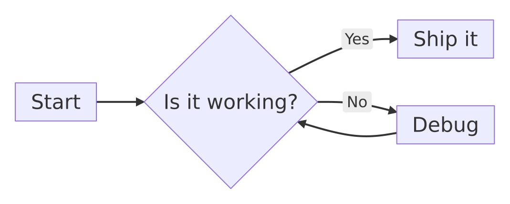

# Tutorial 1 — Your first flowchart

**You will learn:** the shape of a Mermaid document, nodes, labels, links, edge labels and direction.
**Time:** 5 minutes. **Source files:** `docs/examples/01-first.mmd`

## The diagram

```
flowchart LR
    A[Start] --> B{Is it working?}
    B -->|Yes| C[Ship it]
    B -->|No| D[Debug]
    D --> B
```

Render it:

```sh
bin/nimaid docs/examples/01-first.mmd first.png
```



## Line by line

**`flowchart LR`** — declares the diagram type and the direction.
(`graph` works too.) Directions: `LR` left→right, `RL`, `TB`/`TD` top→bottom, `BT`.

**`A[Start]`** — a node. `A` is the node's **id** (used to refer to it); `[Start]` gives it a rectangular shape and the label `Start`.
You can define a node once and refer to it by id afterwards; the label and shape come from the first definition that has them.

**`B{Is it working?}`** — curly braces make a diamond (a decision).

**`-->`** — an arrow. `A --> B` connects A to B.

**`-->|Yes|`** — an arrow with a label. Equivalent: `B -- Yes --> C`.

**`D --> B`** — a link back to an earlier node; nimaid routes it as a loop automatically.

## Try it yourself

1. **Flip the direction.** Change `LR` to `TD` and re-render. The layout rotates.
2. **Chain links.** `A --> B --> C` is shorthand for two links.
3. **Fan out.** `A --> B & C` links A to both B and C; `A & B --> C` links both to C.
4. **Add a label with a line break.** `E[First line<br/>Second line]`.
5. **Add a title.** Put front matter at the very top:

   ```
   ---
   title: Release flow
   ---
   flowchart LR
       ...
   ```

## Node ids — one gotcha

Ids may contain letters and digits, but **must not start with a Mermaid keyword**: `graph`, `class`, `style`, `subgraph` (and the bare word `end`).
`graphics --> B` or `classy --> B` fails to parse (exactly as in Mermaid itself); rename the id to `gfx` / `cls`. (`endpoint` is fine.)
The label in brackets can be anything: `gfx[graphics]` is fine.

## Quotes for special characters

If a label contains brackets, parentheses or other punctuation, put it in double quotes:

```
A["Calls f(x) [fast]"] --> B
```

## Next

[Tutorial 2 — shapes, links and subgraphs](02-shapes-links-subgraphs.md)
