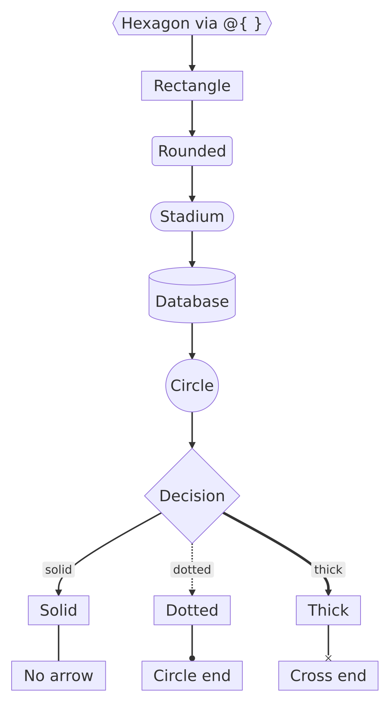
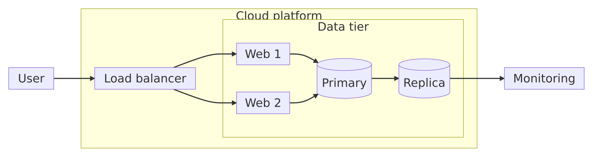

# Tutorial 2 — Shapes, links and subgraphs

**You will learn:** the node shapes, the link types, and how to group nodes with (nested) subgraphs.
**Source files:** `docs/examples/02-shapes-links.mmd`, `docs/examples/03-subgraphs.mmd`

## Shapes and links

```
flowchart TD
    A[Rectangle] --> B(Rounded)
    B --> C([Stadium])
    C --> D[(Database)]
    D --> E((Circle))
    E --> F{Decision}
    F -->|solid| G[Solid]
    F -.->|dotted| H[Dotted]
    F ==>|thick| I[Thick]
    G --- J[No arrow]
    H --o K[Circle end]
    I --x L[Cross end]
    M@{ shape: hex, label: "Hexagon via @{ }" } --> A
```



### Shape cheat-sheet

| Syntax | Shape | | Syntax | Shape |
|---|---|---|---|---|
| `A[text]` | rectangle | | `A{text}` | diamond |
| `A(text)` | rounded | | `A{{text}}` | hexagon |
| `A([text])` | stadium | | `A[/text/]` | parallelogram |
| `A[[text]]` | subroutine | | `A[\text\]` | parallelogram (other way) |
| `A[(text)]` | cylinder / database | | `A[/text\]` | trapezoid |
| `A((text))` | circle | | `A>text]` | flag |
| `A(((text)))` | double circle | | | |

For *every other* shape in Mermaid's registry use the `@{ shape: … }` form:

```
A@{ shape: cyl, label: "Store" }
B@{ shape: doc, label: "Report" }
C@{ shape: fork }
```

About 55 shapes are supported — `rect`, `rounded`, `stadium`, `cyl`, `diam`, `hex`, `lean-r`, `trap-b`, `circ`, `dbl-circ`, `fork`, `doc`, `docs`, `delay`, `tri`, `flag`, `cloud`, `bang`, `bolt`, `folder`, `person`, … The full list is in the [diagram syntax reference](../reference/diagram-syntax.md#flowchart-shapes).

### Link cheat-sheet

| Syntax | Meaning |
|---|---|
| `A --> B` | arrow |
| `A --- B` | line, no arrowhead |
| `A -.-> B` | dotted arrow |
| `A ==> B` | thick arrow |
| `A ~~~ B` | invisible link (only influences layout) |
| `A --o B`  `A --x B` | circle / cross end |
| `A <--> B`  `A o--o B`  `A x--x B` | both ends |
| `A ---> B`  `A ----> B` | longer (adds rank spacing) |
| `A -- text --> B`  `A -->|text| B` | with label |
| `A -. text .-> B`  `A == text ==> B` | labelled dotted / thick |
| `e1@--> B` | give the edge an id (for `linkStyle`/animation metadata) |

## Subgraphs

Subgraphs draw a titled box around a group of nodes. They nest, can set their own `direction`, and edges may point **to or from a subgraph itself**.

```
flowchart LR
    U[User] --> LB
    subgraph Cloud[Cloud platform]
        direction TB
        LB[Load balancer] --> W1[Web 1] & W2[Web 2]
        subgraph Data[Data tier]
            W1 --> DB[(Primary)]
            W2 --> DB
            DB --> R[(Replica)]
        end
    end
    R --> M[Monitoring]
```



Things to notice:

* `subgraph Cloud[Cloud platform]` — `Cloud` is the id, the bracketed text is the title.
* The inner `direction TB` makes the Cloud box flow top-to-bottom even though the outer chart is `LR`.
* Nodes are declared inside the subgraph where they first appear; links can cross subgraph borders freely (`R --> M`).
* Nested subgraphs are laid out recursively, like Mermaid does.

## Try it yourself

1. Link a node **to a subgraph**: `U --> Data`. The arrow ends at the subgraph's border.
2. Give each subgraph a different `direction`.
3. Replace a shape with an `@{ shape: … }` one and re-render.

## Next

[Tutorial 3 — styling and themes](03-styling-and-themes.md)
