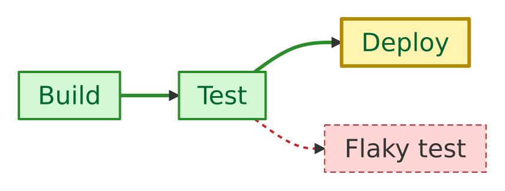
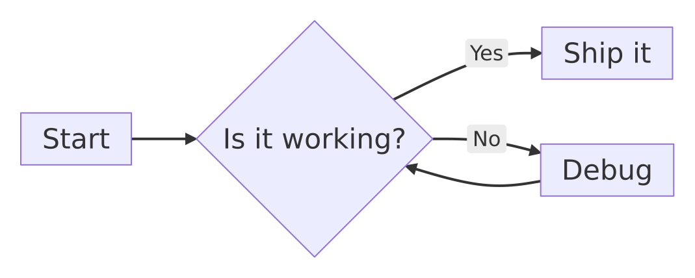
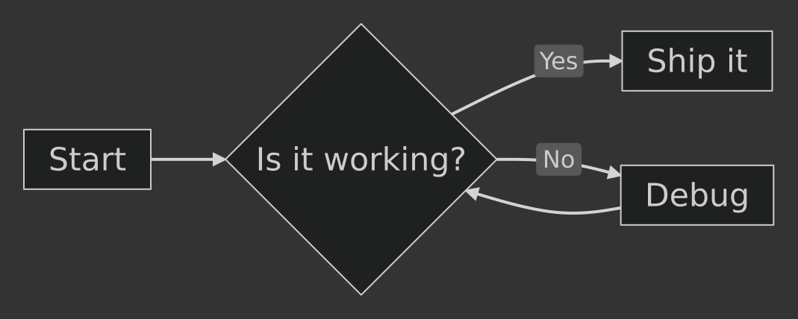
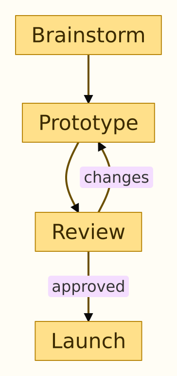

# Tutorial 3 — Styling and themes

**You will learn:** per-node and per-link styling, reusable classes, the five built-in themes, and how to override individual theme colours.
**Source files:** `docs/examples/04-styling.mmd`, `05-theme-vars.mmd`, `06-dark.mmd`

## Styling nodes and links

```
flowchart LR
    classDef good fill:#d4f8d4,stroke:#2a8f2a,stroke-width:2px,color:#063
    classDef bad fill:#ffd6d6,stroke:#c62828,stroke-dasharray:5 3
    A[Build]:::good --> B[Test]:::good --> C[Deploy]:::good
    B --> D[Flaky test]:::bad
    style C fill:#fff3b0,stroke:#b58900,stroke-width:3px
    linkStyle 0,1 stroke:#2a8f2a,stroke-width:3px
    linkStyle 2 stroke:#c62828,stroke-dasharray:4 4
```



| Statement | Effect |
|---|---|
| `classDef name prop:value,…` | Define a reusable style. |
| `A:::name` | Apply a class inline while declaring/using a node. |
| `class A,B name` | Apply a class to several nodes afterwards. |
| `style A prop:value,…` | Style one node directly (beats classes). |
| `linkStyle 0,2 prop:value,…` | Style links by **index** (0 = the first link in the file). |
| `linkStyle default prop:value` | Style all links that have no explicit `linkStyle`. |

Supported properties: `fill`, `stroke`, `stroke-width`, `stroke-dasharray`, `color` (text), `opacity`, `font-size`.
Colours can be `#rgb`, `#rrggbb`, `rgb(r,g,b)` or CSS colour names (`tomato`, `lightblue`, …).

## Themes

Pick a built-in theme on the command line:

```sh
bin/nimaid --theme=dark docs/examples/01-first.mmd first-dark.png
```

| `default` | `dark` |
|---|---|
|  |  |

Available: **`default`**, **`dark`**, **`forest`**, **`neutral`**, **`base`**. Colours are Mermaid's own, evaluated from its theme source.
(`base` is the neutral canvas intended to be customised with `themeVariables`.)

### Choosing a theme inside the diagram

Either as an init directive:

```
%%{init: {'theme': 'forest'}}%%
flowchart LR
    A --> B
```

or as YAML front matter:

```
---
config:
  theme: dark
---
flowchart LR
    A[Client] --> B[API] --> C[(DB)]
```


> The `--theme=` command-line flag **overrides** a theme set inside the diagram.

## Overriding individual colours with `themeVariables`

Start from `base` (or any theme) and override just what you need:

```
%%{init: {'theme': 'base', 'themeVariables': {
    'primaryColor': '#ffe08a', 'primaryBorderColor': '#b8860b',
    'lineColor': '#6b4f00', 'primaryTextColor': '#3b2a00',
    'background': '#fffdf5'}}}%%
flowchart TD
    A[Brainstorm] --> B[Prototype] --> C[Review]
    C -->|approved| D[Launch]
    C -->|changes| B
```



Variables work in both the `%%{init}%%` form and in front matter (`config:` → `themeVariables:`). Values must be hex or `rgb()` colours — CSS colour **names** are accepted in `classDef`/`style`, but not in `themeVariables`.

The full list of variables is in the [theme reference](../reference/themes.md).

## Try it yourself

1. Render `docs/examples/03-subgraphs.mmd` with each of the five themes and compare the cluster colours.
2. Make a "warning" class with a dashed orange border and apply it to one node with `:::warn`.
3. Use `linkStyle default stroke:#999` to quiet all links, then highlight one with `linkStyle 3 stroke:#c00,stroke-width:3px`.

## Next

[Tutorial 4 — other diagram types](04-other-diagrams.md)
