# Tutorial 9 — Charts: pie, XY, timeline, quadrant, journey, packet, kanban, radar, treemap and sankey

**You will learn:** the ten "data" diagram types, their syntax, how to configure them, and how to colour them.
**Source files:** `docs/examples/15-pie.mmd` … `26-pie-config.mmd`

All of them follow Mermaid's own renderers (geometry, defaults and theme colours), work in every theme, and export to PNG, GIF and SVG like any other diagram.

```sh
bin/nimaid docs/examples/15-pie.mmd pie.png
bin/nimaid --theme=dark docs/examples/16-xychart.mmd xy-dark.svg
```

## 1. Pie charts

```
pie showData title Key elements in Product X
    "Calcium" : 42.96
    "Potassium" : 50.05
    "Magnesium" : 10.01
    "Iron" :  5
```

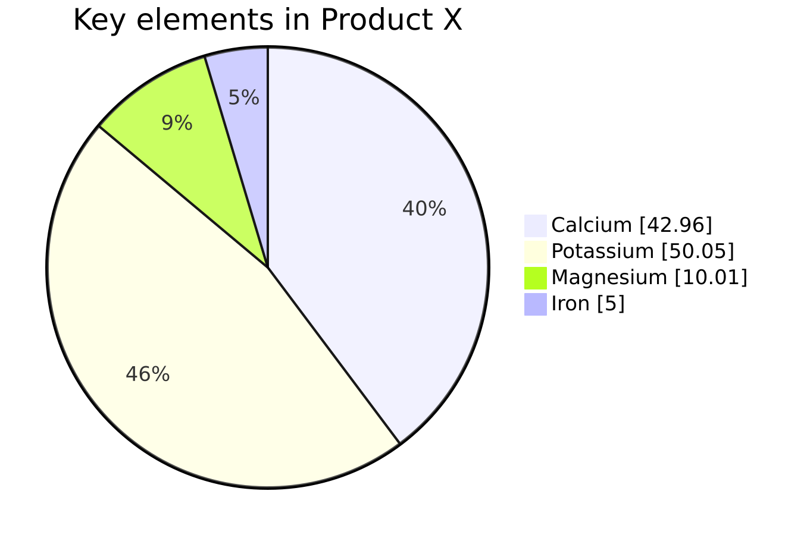

* `pie` — optionally followed by `showData` (adds `[value]` to the legend) and/or `title …`.
* Each slice is `"label" : value` — the label **must be quoted**, the value must be ≥ 0.
* Slices keep the order you wrote them and use the theme's `pie1`…`pie12` colours.
* Like Mermaid, slices under **1 %** are not drawn, and the percentage labels use the total of *all* values.
* Each slice is drawn at 70 % opacity (`pieOpacity`) with a dark outline; slice, outline and legend colours come from the theme (see below).

### Pie options

```
%%{init: {'pie': {'legendPosition': 'bottom', 'donutHole': 0.45, 'highlightSlice': 'Cats', 'textPosition': 0.8}}}%%
pie title Pets adopted
    "Dogs" : 386
    "Cats" : 85
    "Rats" : 15
```

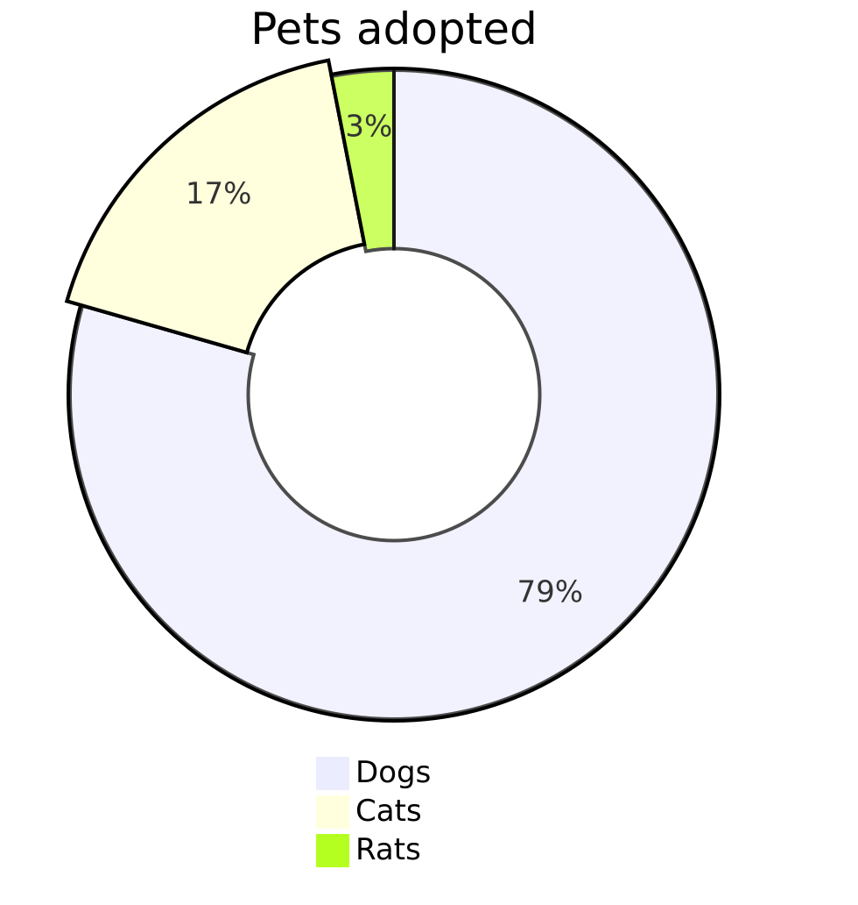

| Option | Default | Meaning |
|---|---|---|
| `legendPosition` | `right` | `right`, `left`, `top`, `bottom` or `center` |
| `textPosition` | 0.75 | where the % labels sit, as a fraction of the radius |
| `donutHole` | 0 | inner radius fraction (0–0.9) — makes a donut |
| `highlightSlice` | – | label of a slice to pull out (scaled 1.05, fully opaque) |

## 2. XY charts (bars and lines)

```
xychart-beta
    title "Sales Revenue"
    x-axis [jan, feb, mar, apr, may, jun, jul, aug, sep, oct, nov, dec]
    y-axis "Revenue (in $)" 4000 --> 11000
    bar [5000, 6000, 7500, 8200, 9500, 10500, 11000, 10200, 9200, 8500, 7000, 6000]
    line [5000, 6000, 7500, 8200, 9500, 10500, 11000, 10200, 9200, 8500, 7000, 6000]
```

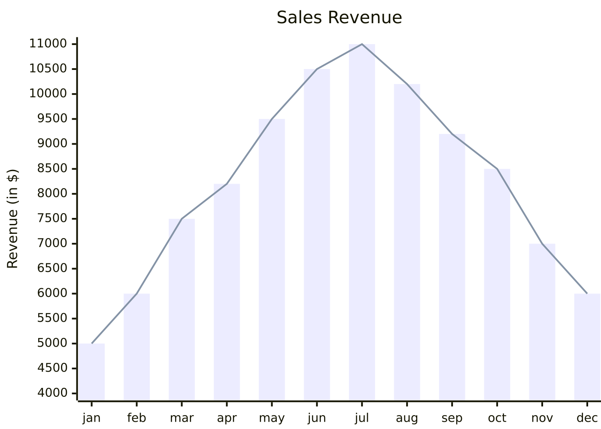

| Statement | Meaning |
|---|---|
| `xychart-beta` or `xychart` | Start. Add `horizontal` to swap the axes. |
| `title "text"` | Chart title. |
| `x-axis [a, b, c]` | **Category** axis. Optional title first: `x-axis "Month" [jan, feb]`. |
| `x-axis "Time" 0 --> 10` | **Numeric** axis with a range. |
| `y-axis "Title" 0 --> 100` | Numeric axis. Without a range, it spans the minimum to the maximum of your data. |
| `bar [..]`, `line [..]` | A data series. Give it a name to get a legend: `bar "Product A" [30, 55]`. |

Notes:

* The axis ticks use d3's "nice" 1-2-5 steps, as Mermaid does.
* As in Mermaid, an automatic y-axis starts at your **minimum value**, not zero — set `y-axis … 0 --> N` if you want a zero baseline.
* Several `bar` series are drawn **on top of each other** (Mermaid does not group them).

### Horizontal bars, legend and data labels

```
%%{init: {'xyChart': {'showDataLabel': true}}}%%
xychart-beta horizontal
    title "Quarterly results"
    x-axis [Q1, Q2, Q3, Q4]
    y-axis "Units" 0 --> 100
    bar "Product A" [30, 55, 80, 65]
    bar "Product B" [20, 40, 45, 90]
    line "Trend" [25, 48, 62, 78]
```

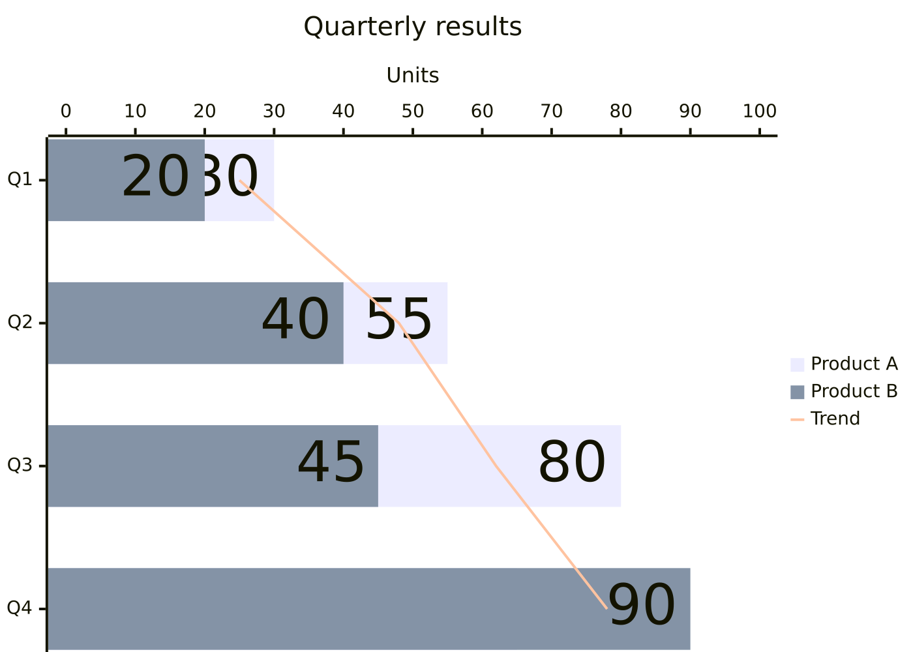

### Configuration

Put options under `xyChart` in an init directive or front matter (`config:`):

| Option | Default | |
|---|---|---|
| `width`, `height` | 700, 500 | chart size in px |
| `chartOrientation` | `vertical` | or `horizontal` |
| `showDataLabel` | false | print values on the bars |
| `showDataLabelOutsideBar` | false | …outside the bar end |
| `plotReservedSpacePercent` | 50 | how much of the chart the plot is guaranteed |
| `titleFontSize`, `titlePadding`, `showTitle` | 20, 10, true | |
| `showLegend`, `legendFontSize`, `legendPadding` | true, 14, 10 | |
| `xAxis` / `yAxis` → `showLabel`, `showTitle`, `showTick`, `showAxisLine`, `labelFontSize`, `labelPadding`, `titleFontSize`, `titlePadding`, `tickLength`, `tickWidth`, `axisLineWidth`, `labelRotation` | 14, 5, 16, 5, 5, 2, 2, 0 | per-axis |

```
%%{init: {'xyChart': {'width': 900, 'xAxis': {'labelRotation': 45}, 'yAxis': {'showTitle': false}}}}%%
```

Series colours come from the theme palette; override it with
`themeVariables: {xyChart: {plotColorPalette: '#e74c3c,#2ecc71'}}` (works in an init directive and in front matter).

## 3. Timelines

```
timeline
    title History of Social Media Platform
    2002 : LinkedIn
    2004 : Facebook : Google
    2005 : YouTube
    2006 : Twitter
```

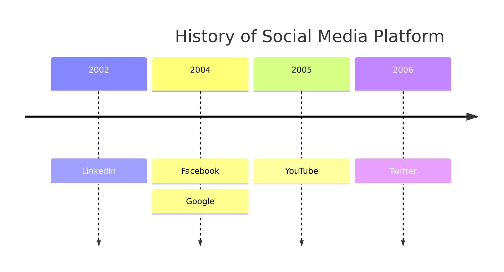

* `period : event` — put several events after one period (`2004 : Facebook : Google`), or continue on the next line with `: another event`.
* `section Name` groups periods; each section gets one colour. Without sections every period gets its own colour.
* Text is wrapped at 150 px; use `<br>` for a forced line break.
* Colours come from the theme's `cScale0…11` family. Events are drawn 20 % brighter than periods (as in Mermaid).
* `timeline TD` is accepted but drawn left-to-right.

## 4. Quadrant charts

```
quadrantChart
    title Reach and engagement of campaigns
    x-axis Low Reach --> High Reach
    y-axis Low Engagement --> High Engagement
    quadrant-1 We should expand
    quadrant-2 Need to promote
    quadrant-3 Re-evaluate
    quadrant-4 May be improved
    Campaign A: [0.3, 0.6]
    Campaign D: [0.78, 0.34] radius: 12
    Campaign E: [0.40, 0.34] color: #ff3300, radius: 8
```

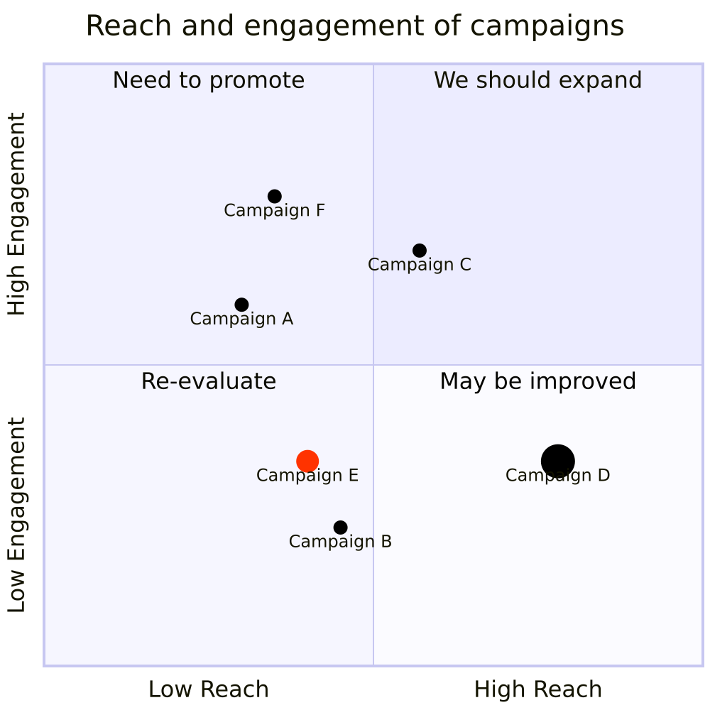

* `x-axis left --> right`, `y-axis bottom --> top`; a lone `x-axis text` labels only the left/bottom end.
* `quadrant-1` is top-right, `-2` top-left, `-3` bottom-left, `-4` bottom-right.
* A point is `Name: [x, y]` with x and y between 0 and 1.
* Style a point inline — `radius`, `color`, `stroke-color`, `stroke-width` — or define a class and apply it:

  ```
  classDef hot color: #ff3300, radius: 10, stroke-color: #660000, stroke-width: 2px
  Launch:::hot: [0.8, 0.9]
  ```
* Options under `quadrantChart`: `chartWidth`, `chartHeight` (500), `pointRadius` (5), `xAxisPosition` (`top`/`bottom`), `yAxisPosition` (`left`/`right`), `quadrantPadding`, `titleFontSize`, `pointLabelFontSize`, … With points present the x-axis labels move to the bottom, as in Mermaid.

## 5. User journeys

```
journey
    title My working day
    section Go to work
      Make tea: 5: Me
      Go upstairs: 3: Me
      Do work: 1: Me, Cat
    section Go home
      Go downstairs: 5: Me
      Sit down: 5: Me
```

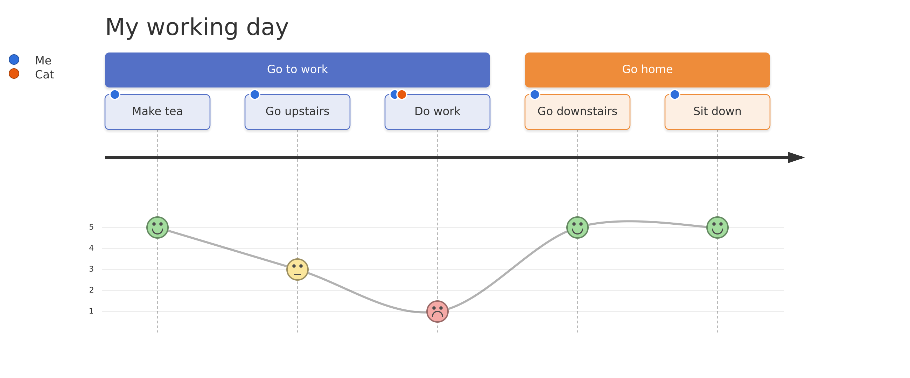

* A task is `Name: score: Actor, Actor` — the score runs from **1** (sad) to **5** (happy) and sets the height of the face on the dashed line below the task.
* Actors get a colour from Mermaid's default palette, shown as a legend on the left (wrapped at 360 px; a wide legend pushes the diagram right) and as dots on each task they take part in.
* `section` headers span their tasks; section/task fills come from the theme's `fillType0…6`.
* The score lines and the axis use the theme's text colour, so they stay visible in dark themes.
* **Colours:** each section has a saturated header (white text) and its tasks use a matching light tint; faces are coloured by mood (red → amber → green) and joined by a smooth emotion curve over faint 1–5 guide lines; actors get distinct colours. Set `journey: {classicColors: true}` for Mermaid's original pastel look (theme `fillType` colours, plain faces).
* Options under `journey`: `leftMargin`, `maxLabelWidth`, `width`, `height`, `taskMargin`, `diagramMarginX/Y`, `actorColours`, `titleColor`.

## 6. Packet diagrams

```
packet
0-15: "Source Port"
16-31: "Destination Port"
32-63: "Sequence Number"
64-95: "Acknowledgment Number"
96-99: "Data Offset"
100-105: "Reserved"
106: "URG"
107: "ACK"
108: "PSH"
109: "RST"
110: "SYN"
111: "FIN"
112-127: "Window"
128-143: "Checksum"
144-159: "Urgent Pointer"
160-191: "(Options and Padding)"
192-255: "Data (variable length)"
```

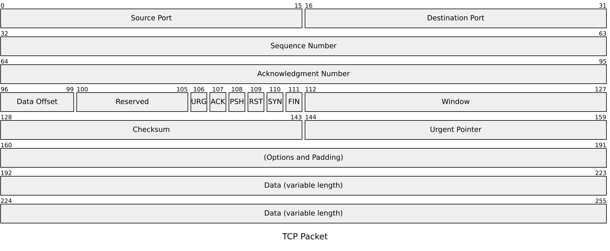

* A field is `start-end: "Label"`, a single bit `106: "URG"`, or a width relative to the previous field `+8: "Label"`.
* Fields must be **contiguous** (no gaps); a field wider than a row simply continues on the next row — `192-255` above spans two rows.
* `title "…"` or front matter `title:` adds a caption.
* Options under `packet`: `bitsPerRow` (32), `bitWidth`, `rowHeight`, `showBits`, `bitOrder` (`ascending`/`descending`), `paddingX/Y`; colours via `themeVariables: {packet: {blockFillColor, blockStrokeColor, labelColor, startByteColor, …}}`.

## 7. Kanban boards

```
kanban
  Todo
    [Create Documentation]
    docs[Create Blog about the new diagram]
  [In progress]
    id6[Create renderer so that it works in all cases.]
  id9[Ready for deploy]
    id8[Design grammar]@{ assigned: 'knsv' }
  id10[Ready for test]
    id4[Create parsing tests]@{ ticket: MC-2038, assigned: 'K.Sveidqvist', priority: 'High' }
  id11[Done]
    id5[define getData]
```

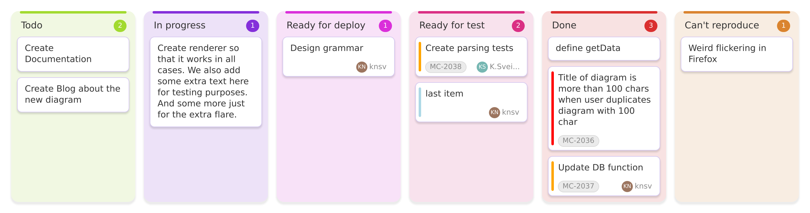

* Columns are the **less-indented** lines; cards are the lines indented under them. Text may be plain, `[bracketed]`, or `id[bracketed]`.
* Card metadata goes in `@{ … }`: `ticket`, `assigned`, `priority` (`Very High`, `High`, `Low`, `Very Low` → a coloured bar on the card edge).
* Columns are soft tints of the theme's `cScale` colours with an accent bar and a card-count badge; cards have a soft shadow, a priority bar, and a footer with the ticket (a pill) and the assignee (an initials avatar and name, shortened to fit).
* Option under `kanban`: `sectionWidth` (200), `classicColors: true` for Mermaid's flat, strongly tinted columns.

## 8. Radar charts

```
---
title: "Grades"
---
radar-beta
  axis m["Math"], s["Science"], e["English"]
  axis h["History"], g["Geography"], a["Art"]
  curve a["Alice"]{85, 90, 80, 70, 75, 90}
  curve b["Bob"]{70, 75, 85, 80, 90, 85}

  max 100
  min 0
```

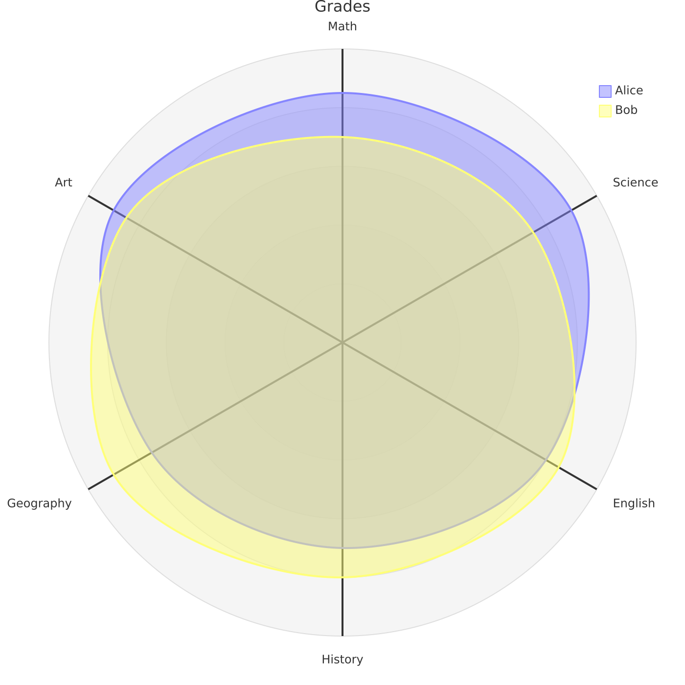

* `axis id["Label"], …` defines the spokes (at least three); `curve id["Label"]{values}` one series — values in axis order, or named `{m: 85, s: 90, …}`.
* Options (one per line, or comma-separated): `max`, `min`, `ticks` (default 5), `showLegend true|false`, `graticule circle|polygon`.
* Config under `radar`: `width`, `height`, margins, `axisScaleFactor`, `axisLabelFactor`, `curveTension`. Colours: `cScale0…` for series, `themeVariables: {radar: {axisColor, graticuleColor, graticuleOpacity, curveOpacity, …}}`.

## 9. Treemaps

```
treemap-beta
"Section 1"
    "Leaf 1.1": 12
    "Section 1.2":::class1
      "Leaf 1.2.1": 12
"Section 2"
    "Leaf 2.1": 20
    "Leaf 2.2": 25
    "Leaf 2.3": 8

classDef class1 fill:red,color:blue,stroke:#FFD600;
```

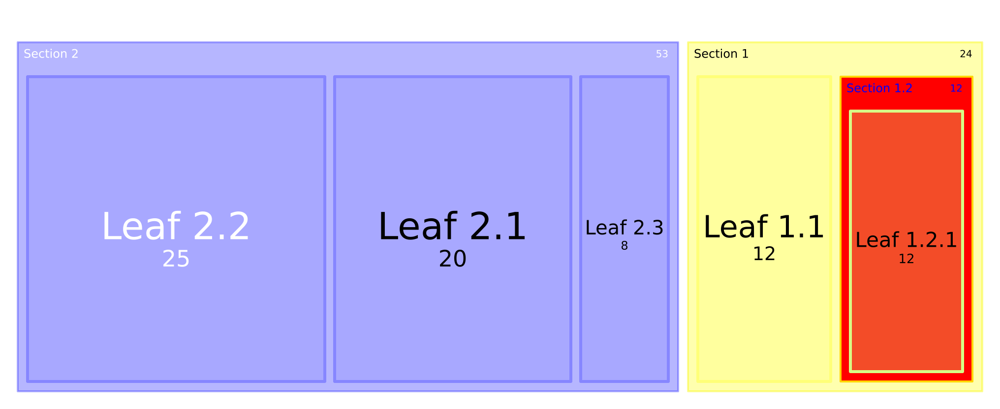

* Names are **quoted**; a row with `: value` is a leaf, a row without is a section containing the rows indented under it. Sections can nest to any depth.
* Areas are proportional to values (d3's squarified layout, largest first); section totals are shown at the right of each header.
* `Name:::class` plus `classDef class fill:…, stroke:…, color:…, stroke-width:…` styles a node (the `classDef` may come anywhere).
* Config under `treemap`: `nodeWidth`/`nodeHeight` (canvas = ×10, default 1000×400), `padding`, `showValues`, `valueFormat` (`,` default; `$,` or `,.2f` style specs).
* Colours cycle through `cScale0…11` by section, as in Mermaid.

## 10. Sankey diagrams

```
---
config:
  sankey:
    showValues: false
---
sankey-beta

%% source,target,value
Solar,Electricity grid,59.9
Wind,Electricity grid,289.4
Electricity grid,Homes,113.7
Electricity grid,Industry,342.2
Electricity grid,Losses,56.7
```

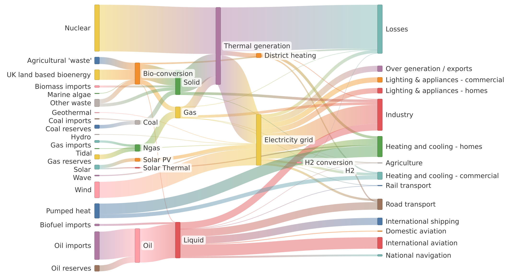

* Each row is a CSV line `source,target,value`; quote fields containing commas (`"Heating, homes"`). Nodes appear in order of first use and keep that colour (Tableau palette).
* Layout is d3-sankey's: columns by depth (`nodeAlignment`: `justify` (default), `left`, `right`, `center`), ribbons proportional to value, relaxation to untangle crossings. Circular flows are rejected.
* Ribbons are a translucent gradient from the source colour to the target colour (`linkColor: gradient`; or `source`, `target`, or any colour) and are painted *under* the nodes and labels.
* **Automatic height:** unless you set `height`, the canvas grows until the nodes fill a healthy share of every column, so busy diagrams never collapse into hairlines.
* **Labels** (`labelStyle: auto`, the default): first-column labels sit to the left of the diagram, the others to the right of their node, each on a soft pill so text stays readable over ribbons; labels are nudged apart so they never overlap, and values appear in a muted tone. `labelStyle: legacy` reproduces Mermaid's placement.
* Config under `sankey`: `width`/`height` (600×400), `nodeWidth` (10), `nodePadding` (12), `showValues` (true — adds the node value to labels and **adds 15 px padding per node**), `prefix`, `suffix`, `labelStyle`, `nodeColors: {id: colour}`.
* **Tip:** Mermaid itself fits 600×400 regardless, which crushes busy diagrams (its docs switch `showValues` off for the big example). nimaid grows the height automatically; set `height` explicitly if you want Mermaid's fixed canvas.

## Colouring the charts

Every chart reads Mermaid's theme variables, so `--theme=dark` etc. just work. To customise, set variables directly:

```
%%{init: {'themeVariables': {'pie1': '#e74c3c', 'pie2': '#3498db', 'pieStrokeColor': '#222'}}}%%
pie
    "Red" : 40
    "Blue" : 60
```

| Chart | Useful variables |
|---|---|
| Pie | `pie1`…`pie12`, `pieTitleTextColor`, `pieSectionTextColor`, `pieLegendTextColor`, `pieStrokeColor`, `pieStrokeWidth`, `pieOuterStrokeColor`, `pieOpacity` |
| XY chart | `xyChart: {backgroundColor, titleColor, plotColorPalette, xAxisLabelColor, yAxisLabelColor, xAxisLineColor, …}` |
| Timeline | `cScale0`…`cScale11`, `cScaleLabel0`…, `cScaleInv0`… |
| Quadrant | `quadrant1Fill`…`quadrant4Fill`, `quadrant1TextFill`…, `quadrantPointFill`, `quadrantPointTextFill`, `quadrantTitleFill`, `quadrantXAxisTextFill`, `quadrantYAxisTextFill`, `quadrantInternalBorderStrokeFill`, `quadrantExternalBorderStrokeFill` |
| Journey | `fillType0`…`fillType7`, `textColor`, `titleColor` |
| Packet | nested `packet: {blockFillColor, blockStrokeColor, blockStrokeWidth, labelColor, startByteColor, endByteColor, titleColor}` (dark theme supplies its own) |
| Radar | nested `radar: {axisColor, axisStrokeWidth, graticuleColor, graticuleOpacity, graticuleStrokeWidth, curveOpacity, curveStrokeWidth}` plus `cScale0…` |
| Kanban, Treemap | `cScale0…11`, `cScaleLabel0…`, `cScalePeer0…`, `background`, `nodeBorder`, `textColor` |
| Sankey | node colours are the fixed Tableau palette; set `sankey: {nodeColors: {…}}` |

> **Note:** these charts use Mermaid's finished theme tables. A *derived* colour is **not** recomputed when you change a base colour, so `primaryColor` alone will not recolour a pie — set the variables listed above instead. (Flowchart-family diagrams do honour `primaryColor`, `lineColor`, etc.)

## Try it yourself

1. Add a third series to the XY chart and turn on `showDataLabel`.
2. Render the quadrant example with `--theme=forest` and `--theme=dark`.
3. Add `classDef` styling to two quadrant points and place them in the "expand" quadrant.
4. Turn the timeline into sections ("Early web", "Social") and compare the colours.
5. Export the journey as SVG and open it in a browser.

## Next

[Diagram syntax reference](../reference/diagram-syntax.md) — every statement and the exact "not yet" lists.
