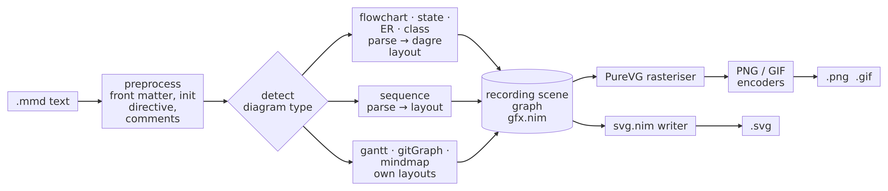
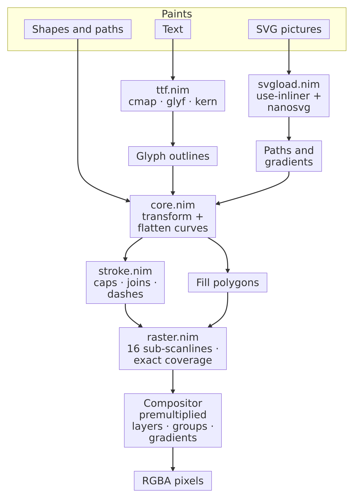

# Architecture

This page explains how nimaid turns text into pixels and vectors, and why it is built this way.

## The big picture

1. **Preprocess** — strip comments, read YAML front matter and `%%{init}%%` directives (theme, `themeVariables`, title).
2. **Detect** the diagram type from the first keyword.
3. **Parse + layout** — each type has its own front half:
   * flowchart: `flowparser` (Mermaid's jison lexer/grammar, ported) → `flowdb` → `dagre_adapter` (Mermaid's cluster/anchor driver on `dagre_nim`).
   * state / ER / class (`diagrams.nim`): line-based parsers that translate into the flowchart layout input, so they share layout, shapes, themes and curves.
   * sequence, Gantt, Git graph, mindmap: own layouts (no graph engine).
   * pie, XY chart, timeline, quadrant, journey ("chart" diagrams): own parsers and layouts that port Mermaid's renderers; they share `chartkit` (drawing helpers) and `chartheme` (theme variables).
4. **Paint** — painters (`painter`, `sequence`, `gantt`, `gitgraph`, `mindmap`, helpers in `drawkit`) draw into a **recording scene graph** (`gfx.nim`) using the same `pvg_*` call names as the engine.
5. **Output** — the recorded scene is either **replayed** into the PureVG rasteriser (then PNG/GIF-encoded), or **serialised** by `svg.nim`.

**Why a recording scene?** Painters are written once. Raster and vector outputs can never drift apart because they replay the *same* list of paints. It also means the engine API and the scene API are interchangeable (see Tutorial 8).

## Module map (`src/nimaid/`)

| Module | Role |
|---|---|
| `preprocess`, `config`, `detect` | front matter, directives, diagram type detection, theme config |
| `flowparser` | Mermaid `flow.jison` lexer (start-condition stack, first-match rules) + recursive-descent grammar |
| `flowdb` | vertices, edges, subgraphs, classes; link destructuring; `@{ }` metadata; `getData` |
| `shapereg`, `shapes` | alias → handler table; geometry (size, path, label offset, outline) for ~55 shapes |
| `dagre_adapter`, `outline` | cluster/anchor edge rewriting, recursive layout, self-loops; edge ↔ shape-border intersection |
| `curves` | d3-style curves: basis, linear, cardinal, catmullRom, natural, monotoneX/Y, step*, bumpX/Y |
| `styles`, `theme` | `classDef`/`style`/`linkStyle` → paint attributes; five presets + `themeVariables` |
| `label`, `textmetrics`, `emoji`, `inflate` | entities, markdown, word-wrap; text measuring through the engine; Noto emoji extraction (cmap, GSUB ligatures, gzip) |
| `diagrams` | state / ER / class parsers → flowchart layout input |
| `sequence`, `gantt`, `gitgraph`, `mindmap`, `drawkit` | the non-graph diagrams and their drawing helpers |
| `pie`, `xychart`, `timeline`, `quadrant`, `journey`, `packet`, `kanban`, `radar`, `treemap`, `sankey` | the chart diagrams (one module each: parse → layout → paint); `treemap` includes d3-hierarchy's squarified tiling and `sankey` a port of d3-sankey |
| `chartkit` | chart helpers: SVG-style text placement by baseline/anchor (incl. rotation), arcs and wedges, arrowheads, shape styling |
| `chartheme` | Mermaid's evaluated theme variables for all five themes (embedded JSON), CSS colour parsing (`#hex`, `rgb()`, `hsl()`, names), diagram overrides |
| `config` | flowchart theme scanner **and** a structured reader (`readConfig`) for nested `%%{init}%%` / YAML front-matter config |
| `painter` | flowchart painting, `rasterizeScene`, `RenderedImage` |
| `gfx` | recording scene graph (same API as the engine) |
| `svg` | scene graph → SVG |
| `deflate`, `png`, `quant`, `gif` | own DEFLATE, adaptive-filter PNG, median-cut quantiser, GIF89a |
| `purevg`, `purevg/*` | the vector engine (below) |

## The PureVG engine

### Geometry (`core.nim`)
Paths are sequences of `M L Q C Z` segments. Before rasterising, every path is **transformed to device space** and **flattened** into polylines.
Curve subdivision is adaptive: the segment count is `ceil(sqrt(0.75·d/tol))` where `d` is the second-difference size of the control polygon and `tol = 0.05 px`, clamped to 1…200. Flattening *after* transforming keeps the error in pixels regardless of scale.

### Rasteriser (`raster.nim`)
A scanline coverage rasteriser designed for **exact horizontal coverage and true winding rules**:

* Each pixel row is sampled at **16 sub-scanlines**.
* Edge crossings are bucketed per sub-scanline, sorted by x, and swept with a winding counter (**nonzero** or **even-odd**).
* Inside spans add *exact fractional* coverage to the two boundary pixels and use a difference array for the interior, so the cost per span is O(1) regardless of length.
* The result is a coverage mask (0…1 per pixel) limited to the shape's bounding box — memory scales with the shape, not the canvas.

Using real winding (not signed-area accumulation) is what lets overlapping stroke pieces union correctly.

### Stroker (`stroke.nim`)
Strokes are converted to **fill polygons**: one quad per segment, one wedge per join (miter with limit 4 → bevel fallback, round, or bevel), caps (butt/round/square), and dashes by walking the polyline by arc length. Every piece is emitted with the same orientation, so filling the whole set with the **nonzero** rule yields their exact union — no self-overlap artefacts, no special cases for closed paths or tight curves.

### Compositing
Layers are **premultiplied float32 RGBA**. Shapes blend through coverage masks; solid colours and gradient ramps share the path. Scenes with opacity < 1 render into an offscreen layer and are composited as a group. The final buffer is converted to the requested colour space (straight or premultiplied, RGBA or BGRA byte order).

### TrueType (`ttf.nim`)
Reads `head hhea maxp hmtx loca glyf cmap kern`. `cmap` formats 4 and 12; simple and composite glyphs (with scaling); implied on-curve points are reconstructed; quadratic outlines are **kept as quadratics** (smaller SVG, exact flattening). Glyphs are cached by codepoint.

**Text layout** (`placeGlyphs` in `purevg.nim`) follows one set of rules for every consumer:
`pixels = points × 96/72`; `scale = pixels / unitsPerEm`; first baseline at `ascent`; next line after `ascent − descent + lineGap`; pairwise kerning from `kern` (the previous glyph carries across newlines); unmapped codepoints are skipped without advancing; alignment shifts each line by `−lineWidth·ax` and the block by `−height·ay`.
Both the rasteriser (via `layoutText`) and the SVG writer (via `placeGlyphs`) use the *same* placements, which is why the SVG's outlined text lines up with the PNG pixel for pixel.

### SVG pictures (`svgload.nim`)
1. A small XML tokenizer builds a tree and indexes ids.
2. Every `<use>` is replaced by a `<g transform>` holding a copy of its target (recursively, up to depth 12) — this is needed for Noto emoji, which are built from shared definitions.
3. The expanded document is parsed by the vendored **nanosvg** port: paths, transforms, styles, gradients.
4. Shapes become engine paints; gradients are stored as stops plus nanosvg's unit-space transform, sampled from a 256-entry colour ramp.

## The SVG writer (`svg.nim`)

* **Outlined text:** each distinct glyph becomes one `<path id="gN">` in `<defs>`; each text run is a `<g>` with a single matrix and `<use>` per glyph. Glyph coordinates are font units with relative commands and no decimals.
* **Live text:** `<text>` per line with explicit `x`/`y` baseline from the shared layout; `textLength` pins the measured width; pt → px conversion done once.
* **Emoji:** each distinct emoji → `<g id="eN">` of relative-command paths with `<linearGradient>`/`<radialGradient>` defs, then `<use>`; the gradient matrix is the inverse of nanosvg's unit-space transform.
* **Shapes:** compact relative path data, only non-default stroke attributes emitted.

## Chart diagrams

The five chart types are ports of Mermaid's own renderers rather than ad-hoc drawings: the geometry constants, layout order and defaults come from the renderer sources (pie 450 px canvas / radius 185; xychart's orchestrator that allocates plot space, title, axes and legend in a fixed order; timeline's 150/200 px grid; the quadrant builder's padding rules; the journey drawing code).
Details worth knowing:

* **Theme data is evaluated, not guessed.** `chartheme` embeds the output of Mermaid's `theme-*.js` for all five themes (`data/chart_themes.json`, ~50 KB). Colours such as `pie1…pie12`, `cScale0…11`, `quadrant*Fill` or `xyChart.plotColorPalette` are therefore exact.
* **SVG text semantics.** Mermaid positions text by baseline and anchor (`text-anchor`, `dominant-baseline`). `chartkit.drawT` reproduces `top`, `middle` and `hanging` references using the bundled font's metrics, so labels land where Mermaid puts them.
* **d3 behaviours that matter** are re-implemented: nice ticks (`d3-array` `ticks`), `scaleBand` with inner padding 1, `d3.pie` angle ordering, arcs.
* **Group opacity.** Pie slices are 70 % opaque as a *group* (CSS `opacity` on the element), so strokes don't double-blend; the scene graph's group opacity replays this exactly in PNG and SVG (`<g opacity>`).
* **Gradients on shapes** (`pvg_shape_set_fill/stroke_gradient`) go through the same coverage-mask + colour-ramp path as SVG gradients, and the SVG writer emits `<linearGradient>` — this is how sankey ribbons look identical in PNG and SVG.
* **Rotation** is a first-class paint transform (translate · rotate · scale) in the engine, the scene recorder and the SVG writer — used for y-axis titles.

## Validation

| What | How | Result |
|---|---|---|
| Engine + charts | `tests/test_purevg.nim` — rasteriser coverage, winding rules, stroker areas, TrueType metrics and kerning, SVG loader, canvas, gradients, end-to-end, colour/config parsing and every chart type | 49 tests |
| PNG output | `tests/visual_regression.py` vs golden `examples/*.png` (produced by the previous backend) | mean diff ≤ 0.09/255; ≤ 0.001 % of pixels differ visibly |
| SVG output | same script, SVG rendered by resvg at 2× vs the PNG | mean diff ≤ 0.23/255; ≤ 0.003 % pixels differ visibly; cairosvg also agrees on the examples spot-checked (emoji, basic, nested) |
| Flowchart parser | `tests/conformance.py` — assertions extracted from Mermaid's own specs | 737/752 checkable pass |
| Flowchart layout | `tools/jscheck` — differential fuzzing against `dagre-d3-es` | matches except ~2 in 1,800 random compound graphs (1–10 px) |
| Syntax coverage | `tests/coverage_diagrams.py` on Mermaid spec charts | state 95/98, ER 75/75, class 39/39, git 53/58 |

## Design decisions and trade-offs

* **Pure Nim, no FFI.** Easy to build and ship; no ABI problems. The cost is writing a rasteriser — kept small (about 1,100 lines of Nim for the whole engine, plus the vendored 1,850-line nanosvg parser) and tested.
* **Software rendering at 16 sub-scanlines.** Chosen for exact horizontal coverage and simplicity. It is not the fastest possible; typical diagrams still render in well under a second.
* **Outline text by default in SVG.** Guarantees fidelity; the live-text mode exists for accessibility and editing.
* **Recording scene instead of direct drawing.** One code path for all outputs.
* **One text font at a time.** Keeps measuring and drawing consistent; multi-font fallback would complicate layout.
* **`legacyOrder` dagre.** Matches Mermaid's output rather than the newer dagre tie-breaking.

## Known deviations from Mermaid

Positions in mindmaps (balanced tree vs. force layout) and Git graph commit-id rotation differ; see the [diagram syntax reference](reference/diagram-syntax.md) for per-diagram lists.
