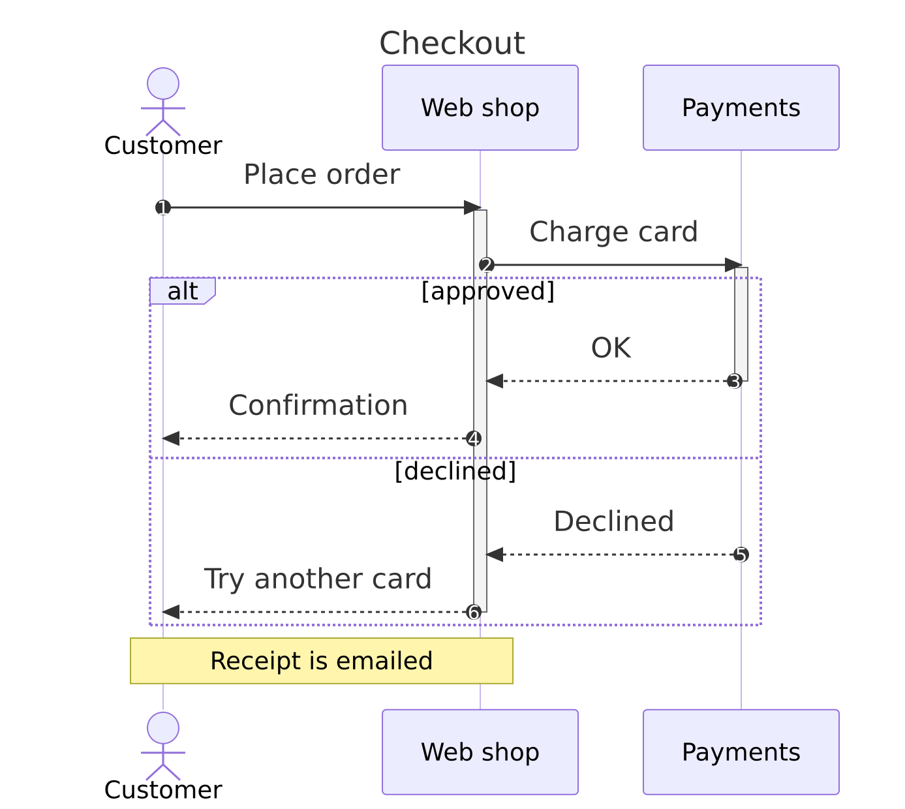
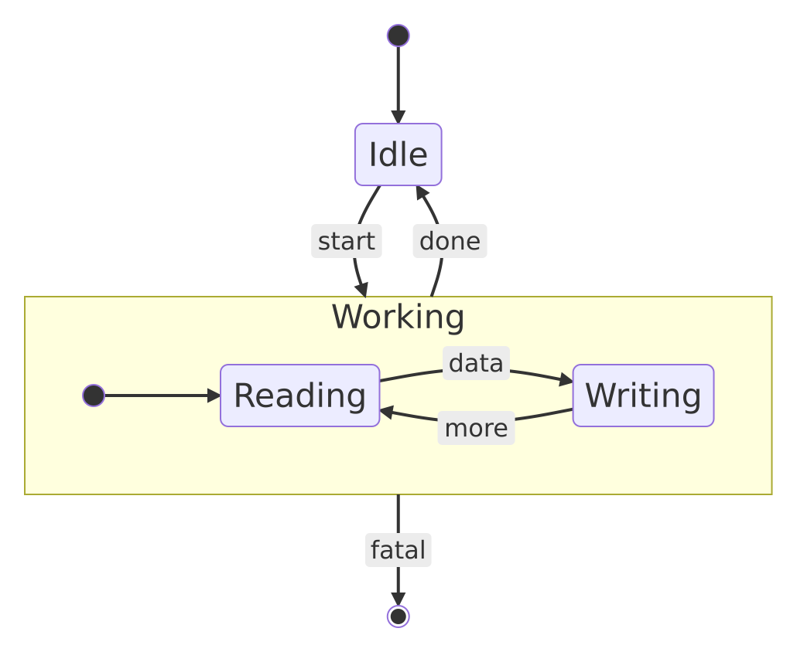
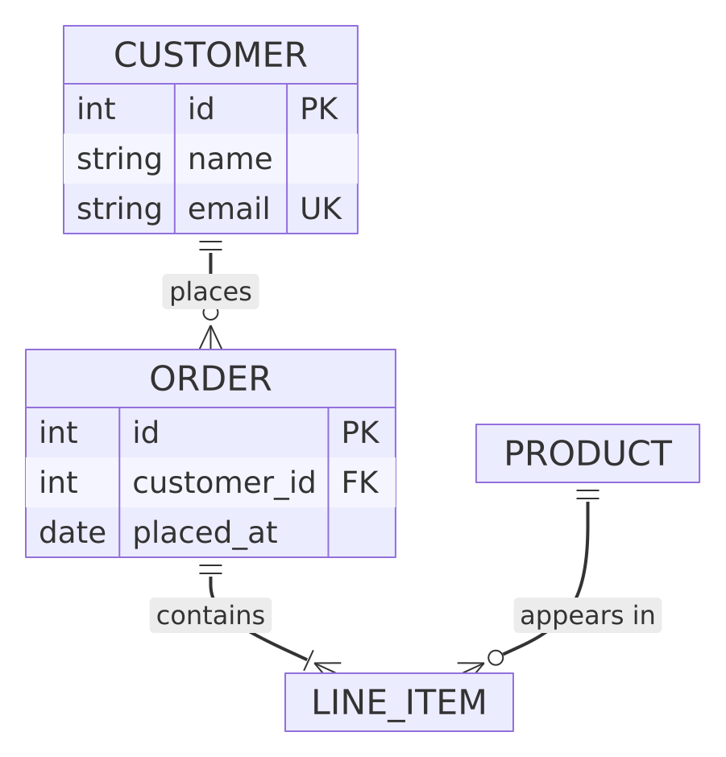
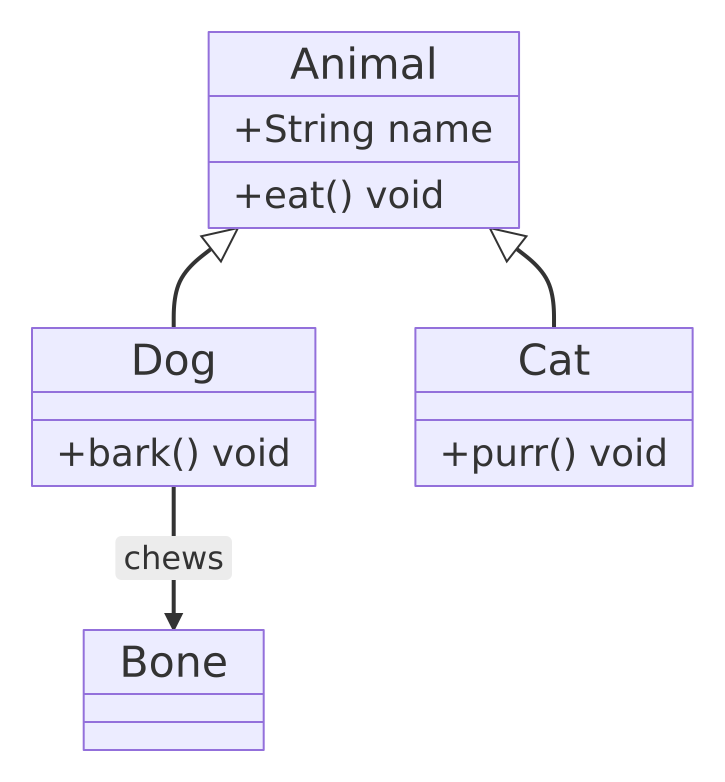
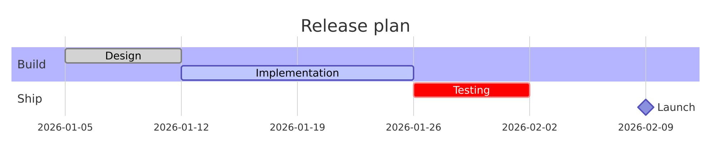
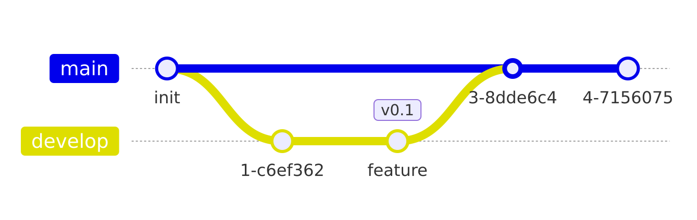
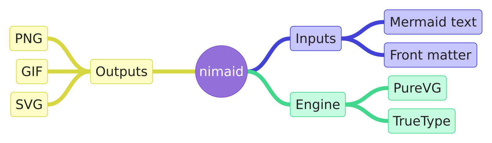

# Tutorial 4 — Other diagram types

nimaid draws eight kinds of diagram. The type is detected from the first keyword, so the command is always the same:

```sh
bin/nimaid diagram.mmd diagram.png
```

Source files for everything below live in `docs/examples/`.

## Sequence diagrams

```
sequenceDiagram
    title Checkout
    autonumber
    actor U as Customer
    participant W as Web shop
    participant P as Payments
    U->>+W: Place order
    W->>+P: Charge card
    alt approved
        P-->>-W: OK
        W-->>U: Confirmation
    else declined
        P-->>W: Declined
        W-->>-U: Try another card
    end
    Note over U,W: Receipt is emailed
```



* `->>` solid arrow, `-->>` dashed arrow; also `->`, `-->`, `-x`, `--x`, `-)`, `--)`.
* `+`/`-` after the arrow activate/deactivate the receiver (`->>+W` … `-->>-U`).
* Fragments: `loop`, `opt`, `alt/else`, `par/and`, `critical/option`, `break`, `rect rgb(…)` — all nestable.
* Notes: `Note left of A`, `Note right of A`, `Note over A,B`.
* `autonumber`, `title`, `box` groups, `actor` (stick figure) vs `participant`.

## State diagrams

```
stateDiagram-v2
    [*] --> Idle
    Idle --> Working : start
    state Working {
        [*] --> Reading
        Reading --> Writing : data
        Writing --> Reading : more
    }
    Working --> Idle : done
    Working --> [*] : fatal
```



`[*]` is the start/end marker; `state X { … }` makes a composite (nested) state; `<<choice>>`, `<<fork>>` and `<<join>>` are supported; `note right of X : text` adds notes.

## Entity–relationship diagrams

```
erDiagram
    CUSTOMER ||--o{ ORDER : places
    ORDER ||--|{ LINE_ITEM : contains
    PRODUCT ||--o{ LINE_ITEM : "appears in"
    CUSTOMER {
        int id PK
        string name
        string email UK
    }
```



Cardinality symbols: `||` exactly one, `|o` / `o|` zero or one, `}|` / `|{` one or more, `}o` / `o{` zero or more. `--` is an identifying (solid) relationship, `..` non-identifying (dashed). Attribute rows are `type name [PK|FK|UK] ["comment"]`.

## Class diagrams

```
classDiagram
    class Animal {
        +String name
        +eat() void
    }
    Animal <|-- Dog
    Animal <|-- Cat
    Dog --> Bone : chews
```



Members containing `(` are methods. Relations: `<|--` inheritance, `*--` composition, `o--` aggregation, `-->` association, `..>` dependency, `..|>` realisation, `--` link. Generics use `Foo~T~`; annotations `<<interface>>`.

## Gantt charts

```
gantt
    title Release plan
    dateFormat YYYY-MM-DD
    section Build
    Design        :done, des, 2026-01-05, 7d
    Implementation:active, impl, after des, 14d
    section Ship
    Testing       :crit, after impl, 7d
    Launch        :milestone, 2026-02-09, 0d
```



Task line: `name : [crit|done|active|milestone,] [id,] start | after other, end | duration`. Durations use `d w h m s`. A task with only a duration starts after the previous task.

## Git graphs

```
gitGraph
    commit id: "init"
    branch develop
    checkout develop
    commit
    commit id: "feature" tag: "v0.1"
    checkout main
    merge develop
    commit
```



`commit [id: "…"] [tag: "…"] [type: NORMAL|REVERSE|HIGHLIGHT]`, `branch`, `checkout` (or `switch`), `merge`, `cherry-pick id: "…"`.

## Mindmaps

```
mindmap
  root((nimaid))
    Inputs
      Mermaid text
      Front matter
    Outputs
      PNG
      GIF
      SVG
    Engine
      PureVG
      TrueType
```



The tree is defined purely by **indentation**. Node shapes: `id[square]`, `id(round)`, `id((circle))`, `id))bang((`, `id)cloud(`, `id{{hexagon}}`. Branches are coloured automatically and emoji work everywhere.

## Data charts

Pie, XY (bar/line), timeline, quadrant and user-journey charts are covered in [Tutorial 9](09-charts.md).

## What each type does not do (yet)

See the [diagram syntax reference](../reference/diagram-syntax.md) for the precise "supported / not yet" list for each type.

## Next

[Tutorial 5 — text, fonts and emoji](05-text-fonts-emoji.md)
