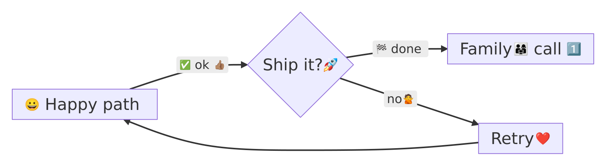

# Tutorial 5 — Text, fonts and emoji

**You will learn:** how labels are laid out, how to use your own font (including CJK), and how colour emoji work.
**Source file:** `docs/examples/14-emoji.mmd`

## Label basics

| You write | You get |
|---|---|
| `A[First<br/>Second]` or `A["First\nSecond"]` | two lines |
| `A[A very long label that goes on and on…]` | automatic word-wrap at ~200 px |
| `A[Tom #9829; Jerry]`, `#quot;`, `#amp;` | HTML/Mermaid entities → ♥ " & |
| `A["**bold** and _italic_"]` | markdown markers are stripped (one font weight is used) |
| `A["Calls f(x) [fast]"]` | quote labels that contain brackets or parentheses |

Text is shaped with **kerning** from the font's `kern` table, and multi-line text is aligned per line, exactly as the PNG and SVG drawers expect.

## Using a different font

```sh
bin/nimaid --font=/path/to/MyFont.ttf flow.mmd flow.png
```

Requirements for the font file:

* **TrueType outlines** (`glyf` table, magic `00 01 00 00` or `true`). Typical `.ttf` files qualify.
* **Not** CFF-flavoured `.otf` (magic `OTTO`) and **not** `.ttc` collections — extract a single face first.

Node sizes are computed from the font you choose, so boxes always fit their text.

### CJK and other scripts

The bundled DejaVu Sans covers Latin, Greek, Cyrillic and many symbols — **not** Chinese/Japanese/Korean.
Characters the font lacks are **skipped** (no placeholder box). To draw CJK text, pass any CJK TrueType font:

```sh
bin/nimaid --font=/usr/share/fonts/truetype/…/YourCJKFont.ttf diagram.mmd diagram.png
```

(Verified with a Japanese TrueType font: `日本語 こんにちは` renders correctly.)

## Colour emoji

Emoji are drawn in full colour inline with the text — in node labels, edge labels, titles, cluster titles and sequence diagrams.

```
flowchart LR
    A[😀 Happy path] -->|✅ ok 👍🏽| B{Ship it? 🚀}
    B -->|🏁 done| C[Family 👨‍👩‍👧 call 1️⃣]
    B -->|no 🙅| D[Retry ❤️]
    D --> A
```



What works: plain emoji, **VS16** presentation (`❤️`), **skin tones** (`👍🏽`), **flags** (`🇮🇳`), **ZWJ sequences** (`👨‍👩‍👧`), **keycaps** (`1️⃣`).
Text-style symbols such as `→` or `♥` stay in the normal font unless followed by the emoji selector (VS16).

The emoji font is `fonts/NotoColorEmoji-Regular.ttf` (the *OpenType-SVG* flavour, whose glyphs are vector). Override with `--emoji=`.
If the emoji font cannot be found, emoji are simply skipped; text rendering is unaffected.

In **SVG output** each distinct emoji is converted to native paths and gradients **once** and re-used, so even emoji-heavy diagrams stay small and render without any font on the viewer's side.

## Try it yourself

1. Render the emoji example as `.svg` and open it in a browser: the emoji are vector, so zoom in as far as you like.
2. Add a flag (`🇯🇵`) and a family (`👩‍👩‍👧‍👦`) to a label.
3. Render with `--font=` pointing at a different TrueType font and compare node sizes.

## Next

[Tutorial 6 — PNG, GIF and SVG](06-output-formats.md)
