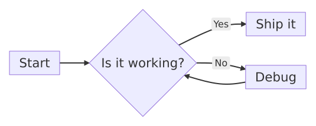

# Tutorial 6 — PNG, GIF and SVG

**You will learn:** which format to choose, how to control size and sharpness, and the difference between outlined and live SVG text.
**Source file:** `docs/examples/01-first.mmd`

All three formats come from **one drawing pass**: nimaid draws the diagram into a recording scene, then either rasterises it (PNG/GIF) or serialises it (SVG).
So the formats always agree with each other.

## Size comparison

The same 5-node diagram (`01-first.mmd`), measured:

| Command | Output | Pixels | Size |
|---|---|---|---|
| `nimaid in.mmd out.png` | truecolour PNG, 2× | 1069 × 428 | 29.7 KB |
| `nimaid --scale=1 …` | PNG, 1× | 535 × 214 | 14.0 KB |
| `nimaid --scale=3 …` | PNG, 3× | — | 46.0 KB |
| `nimaid --colors=64 …` | palette PNG, 2× | 1069 × 428 | 13.9 KB |
| `nimaid --colors=16 …` | palette PNG, 2× | 1069 × 428 | 10.9 KB |
| `nimaid in.mmd out.gif` | GIF, 2× | 1069 × 428 | 16.5 KB |
| `nimaid in.mmd out.svg` | SVG, outlined text | vector | 8.9 KB |
| `nimaid --svg-text=text in.mmd out.svg` | SVG, live text | vector | 3.8 KB |

Across all bundled examples the ranges are PNG 45–315 KB, GIF 25–145 KB, SVG 10–60 KB.

## Choosing a format

| Use… | when |
|---|---|
| **SVG (outlined)** | web pages, documentation, print, anything that scales. Looks identical in every viewer; no font needed. **Best default.** |
| **SVG (live text)** | you want text to be selectable, searchable or editable, and a similar font is available where it will be viewed. |
| **PNG** | chat, slides, READMEs on hosts that don't render SVG. Use `--scale=2` (default) for crisp retina output. |
| **Palette PNG** (`--colors=N`) | you want the smallest PNG. 64 colours is usually visually lossless for flat diagrams; avoid very low values with many emoji or gradients. |
| **GIF** | legacy systems that require GIF. It is a *static* GIF; animation is not supported. |

## Scale

`--scale` multiplies the pixel size for PNG/GIF. `1` is "CSS pixels"; `2` (default) is retina; `3` is extra crisp for print.
SVG has no scale — it is a vector and you pick the display size in your page (``).

## SVG in depth

### Outlined text (default)

```sh
bin/nimaid docs/examples/01-first.mmd first.svg
```



Every glyph is converted to a path, defined **once** inside `<defs>`, and placed with `<use>`:

```xml
<defs>
<path id="g1" d="M201-1493h202v1493h-202v-1493z"/>      <!-- one glyph, in font units, relative commands -->
<path id="g2" d="M907-1087v174q-78-40-162-60…z"/>
…
</defs>
<g aria-label="Start" transform="matrix(0.010417 0 0 0.010417 0 19.8)" fill="rgb(51,51,51)">
  <use xlink:href="#g12" x="-2501.5" y="-1192"/><use xlink:href="#g4" x="-1201.5" y="-1192"/>…
</g>
```

Because the text is geometry, the layout is **exactly** what the PNG shows — kerning included — whatever fonts the viewer has installed.
Each group carries an `aria-label` with the original text for accessibility.

### Live text

```sh
bin/nimaid --svg-text=text docs/examples/01-first.mmd first-live.svg
```

```xml
<g xml:space="preserve" font-family="'DejaVu Sans', Verdana, 'Trebuchet MS', Arial, sans-serif"
   font-size="21.33" fill="rgb(51,51,51)">
  <text x="-26.06" y="7.39" textLength="52.11" lengthAdjust="spacing">Start</text>
</g>
```

Text stays text. Two safeguards keep it looking right even with a fallback font:
explicit baselines (no reliance on `dominant-baseline`, which many viewers ignore) and `textLength`, which forces each line to the width nimaid measured, so labels never overflow their boxes.
Lines containing characters the font lacks omit `textLength`.

### Emoji in SVG

Each distinct emoji becomes a `<g id="eN">` of plain `<path>`s plus `<linearGradient>`/`<radialGradient>` definitions, and every occurrence is a `<use>`.
No nested `<svg>`, no external references — the file is fully self-contained.

### Using the SVG on the web

```html

```

Or inline it (the SVG declares `xmlns` and `xmlns:xlink`). Outlined SVGs render identically in browsers, resvg, cairosvg and Inkscape-style editors.

## Try it yourself

1. Render `examples/emoji.mmd` as PNG, GIF and both SVG modes; compare sizes.
2. Open the live-text SVG in a text editor and find your label text; then open the outlined one and notice it is gone (only `aria-label` remains).
3. Render with `--colors=8` and look for banding on anti-aliased edges.

## Next

[Tutorial 7 — using nimaid as a library](07-library.md)
