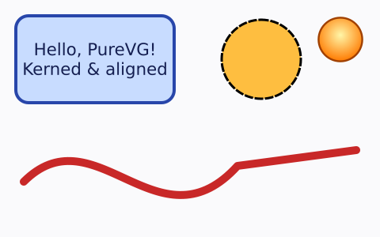
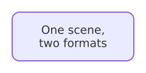
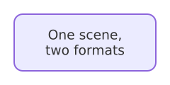

# Tutorial 8 — Drawing with the PureVG engine

**You will learn:** how to use the vector engine directly — shapes, strokes, dashes, text, SVG pictures — and how to export one drawing as both pixels and SVG.
**Source files:** `docs/examples/engine_demo.nim`, `docs/examples/scene_both.nim` (both compiled and run).

PureVG is the engine nimaid uses to draw. It has nothing to do with Mermaid, so you can use it for any 2-D graphics: badges, charts, share-cards, simple UI renderings.



## The mental model

* A **canvas** owns a pixel buffer. You add **paints** to it and call `draw`.
* A paint is a **shape** (path with fill/stroke), a **text**, a **picture** (SVG), or a **scene** (a group of paints).
* Every paint can be **translated**, **scaled**, **rotated** and given an **opacity**.
* Coordinates are pixels, origin top-left, **y grows downward**.
* Functions return a `Pvg_Result`; `PVG_RESULT_SUCCESS` means OK. The examples `discard` it for brevity — check it in real code.

## Step 1 — a canvas

```nim
import nimaid/purevg, nimaid/png

const W = 480
const H = 300
discard pvg_engine_init(0)
discard pvg_font_load("fonts/DejaVuSans.ttf")      # registered as "DejaVuSans" (file name without extension)

var pixels = newSeq[uint32](W * H)                  # one uint32 per pixel
let canvas = pvg_swcanvas_create(PVG_ENGINE_OPTION_DEFAULT)
discard pvg_swcanvas_set_target(canvas, addr pixels[0], W, W, H, PVG_COLORSPACE_ABGR8888S)
```

`PVG_COLORSPACE_ABGR8888S` means: 4 bytes per pixel in memory order **R, G, B, A**, **straight** (non-premultiplied) alpha — the format PNG encoders want.
(`ABGR8888` is the premultiplied variant; the `ARGB…` variants swap R and B.)

## Step 2 — shapes

```nim
let card = pvg_shape_new()
discard pvg_shape_append_rect(card, 20, 20, 200, 110, 16, 16, true)   # x, y, w, h, rx, ry, clockwise
discard pvg_shape_set_fill_color(card, 200, 220, 255, 255)             # r, g, b, a
discard pvg_shape_set_stroke_width(card, 4)
discard pvg_shape_set_stroke_color(card, 40, 70, 170, 255)
discard pvg_canvas_add(canvas, card)
```

Paints are drawn **in the order added** (painter's algorithm). Other builders:

| Function | Purpose |
|---|---|
| `pvg_shape_append_circle(p, cx, cy, rx, ry, cw)` | ellipse/circle |
| `pvg_shape_move_to` / `line_to` / `cubic_to` / `close` | free-form paths |
| `pvg_shape_set_stroke_dash(p, ptr, count, offset)` | dash pattern (array of on/off lengths) |
| `pvg_shape_set_stroke_cap` | `PVG_STROKE_CAP_BUTT/ROUND/SQUARE` |
| `pvg_shape_set_stroke_join` | `PVG_STROKE_JOIN_MITER/ROUND/BEVEL` |

A path with a **fill** is filled with the *nonzero* winding rule; semi-transparent colours blend correctly (`a` < 255).

> **Defaults:** stroke cap = **square**, join = **bevel**, miter limit 4 (fixed). Set cap and join explicitly if you care.

### Dashed outline

```nim
var dashes = [8.0'f32, 5.0'f32]                      # 8 on, 5 off
discard pvg_shape_set_stroke_dash(dot, addr dashes[0], 2, 0)
```

### Curves with round joins

```nim
let wave = pvg_shape_new()
discard pvg_shape_move_to(wave, 30, 230)
discard pvg_shape_cubic_to(wave, 120, 140, 200, 320, 300, 210)   # two control points + end point
discard pvg_shape_line_to(wave, 450, 190)
discard pvg_shape_set_stroke_width(wave, 10)
discard pvg_shape_set_stroke_join(wave, PVG_STROKE_JOIN_ROUND)
discard pvg_shape_set_stroke_cap(wave, PVG_STROKE_CAP_ROUND)
```

## Step 3 — text

```nim
let label = pvg_text_new()
discard pvg_text_set_font(label, "DejaVuSans")
discard pvg_text_set_size(label, 16)                 # POINTS: 16 pt = 21.3 px
discard pvg_text_set_text(label, "Hello, PureVG!\nKerned & aligned")
discard pvg_text_set_color(label, 20, 30, 80)
discard pvg_text_align(label, 0.5, 0.5)              # centre horizontally and vertically on the origin
discard pvg_paint_translate(label, 120, 75)          # …which is placed at (120, 75)
discard pvg_canvas_add(canvas, label)
```

Text rules worth knowing:

* **Size is in points**; pixel size = points × 96/72.
* `pvg_text_align(x, y)` (each 0…1) positions the text block relative to the paint's origin: `(0,0)` top-left, `(0.5,0.5)` centred, `(1,0)` right-aligned. Each line is aligned individually.
* `\n` starts a new line; line spacing is the font's `ascent − descent + lineGap`.
* **Kerning** from the font's `kern` table is applied.
* Characters the font does not contain are **skipped** (no advance, no box).
* Measure text with `pvg_paint_get_aabb(text, &x, &y, &w, &h)` or `pvg_text_get_text_metrics`.

## Step 4 — SVG pictures

```nim
const badge = """<svg xmlns="http://www.w3.org/2000/svg" viewBox="0 0 100 100">
  <defs><radialGradient id="g" cx="50%" cy="40%" r="60%">
    <stop offset="0" stop-color="#fff6a8"/><stop offset="1" stop-color="#ff7a00"/></radialGradient></defs>
  <circle cx="50" cy="50" r="46" fill="url(#g)" stroke="#a04000" stroke-width="4"/></svg>"""
let pic = pvg_picture_new()
discard pvg_picture_load_data(pic, badge.cstring, uint32(badge.len), "svg", nil, true)
discard pvg_picture_set_size(pic, 60, 60)            # fit into 60x60, aspect preserved, centred
discard pvg_paint_translate(pic, 400, 20)
discard pvg_canvas_add(canvas, pic)
```

Supported SVG: paths (all commands, including arcs and quadratics), basic shapes, `transform`, `<g>`, `<defs>`/`<use>`, `style`/presentation attributes, `opacity`, solid colours, and **linear/radial gradients** (with `gradientTransform` and `xlink:href` inheritance).
Not supported: filters, masks, clip-paths, patterns, `<image>`, `<text>`.

## Step 5 — draw and save

```nim
discard pvg_canvas_draw(canvas, true)                # true = start from transparent; false = draw on top of what is already in the buffer
discard pvg_canvas_sync(canvas)

var rgba = newSeq[byte](W * H * 4)
copyMem(addr rgba[0], addr pixels[0], rgba.len)
writePng("engine_demo.png", rgba, W, H)
discard pvg_engine_term()
```

## Draw once, export twice (PNG **and** SVG)

`nimaid/gfx` exposes the **same `pvg_*` function names** but *records* a scene graph instead of drawing. You can then replay it as pixels or serialise it to SVG:

```nim
import nimaid/[gfx, svg, png]
from nimaid/purevg import pvg_engine_init, pvg_font_load        # qualified to avoid clashing with gfx

discard pvg_engine_init(0)
discard pvg_font_load("fonts/DejaVuSans.ttf")

let root = pvg_scene_new()
# … build paints exactly as above, then pvg_scene_add(root, paint) …

writePng("scene_both.png", renderRgba(root, 240, 120), 240, 120)
writeFile("scene_both.svg", toSvg(root, 240, 120, [255'u8, 255, 255, 255]))   # outlined text
# toSvg(root, w, h, bg, textMode = stText) keeps text as live <text>
```

<table><tr>
<td><br><sub>scene_both.png</sub></td>
<td><br><sub>scene_both.svg (same scene)</sub></td>
</tr></table>

This is exactly how nimaid itself produces PNG, GIF and SVG from one drawing pass.

## Going further

* Every function, enum and default: [PureVG API reference](../reference/purevg-api.md).
* How the rasteriser, stroker, TrueType reader and SVG loader work: [Architecture](../architecture.md).
* The two programs above in full: `docs/examples/engine_demo.nim`, `docs/examples/scene_both.nim`.
